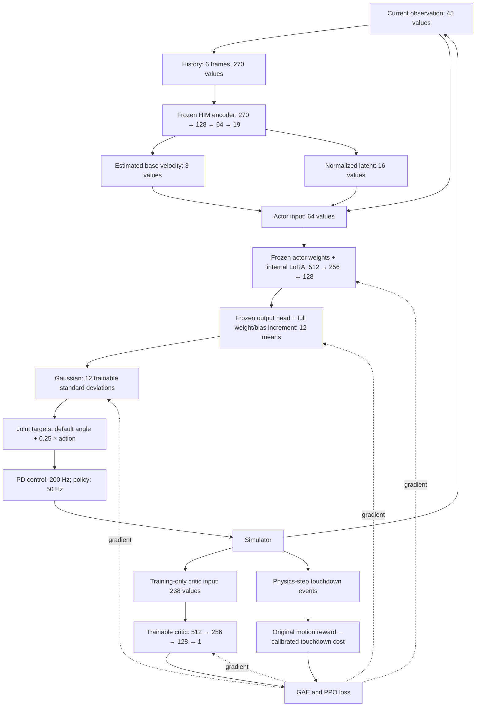

# Frozen HIM quiet adaptation, V1

Train a layer-internal adapter around a converged Go1 HIM checkpoint. Keep the
base actor and the entire HIM estimator fixed. Train the adapter, one critic,
and the Gaussian standard deviation with PPO. Actor inputs and PD control stay
the same. Disabling the adapter restores the original mean and standard deviation.

The default hidden ranks are 8/16/8. The output head uses full weight and bias
increments. There are 21,516 adapter parameters. Other experiment modes are
`frozen` (zero mean-network parameters), `head` (1,548), and `full` (199,052).
Full tuning is an empirical comparison, not a performance upper bound.

## Information and gradient flow



Each current frame contains commands (3), body angular velocity (3), projected
gravity (3), joint angle errors (12), joint velocities (12), and previous actions
(12). The history starts with the newest frame. The critic adds true body
velocity (3), external force (3), and terrain-height samples (187). These added
values do not enter the actor. Dynamics parameters affect simulation but are not
explicit actor or critic inputs in this version.

Each hidden actor layer computes `ELU(W0 h + b0 + B A h)`. The output layer
computes `(W0 + delta_W) h + b0 + delta_b`. All increments start at zero through
zero B/output initialization. The encoder uses ELU hidden layers and L2-normalizes
its 16 latent outputs. The actor output has no activation.

PPO calls `loss.backward()` and `optimizer.step()` for the adapter, critic and
standard deviation. `update_estimator=False` skips the separate HIM estimator
optimizer. There is no gradient path to a frozen parameter. PPO storage retains
the raw Gaussian sample and its log probability before environment clipping.
Evaluation uses the deterministic mean.

Reward calibration lives in the robot instance and checkpoint `calibration`
metadata. `set_quiet_reward` does not write into the configuration object.
`BaseConfig` creates nested configuration instances, but the registry can return
the same configuration instance more than once.

The quiet cost in one control period is the sum of squared downward speeds at
touchdown. Its fixed reference is baseline cost per second. The reward helper
divides by both that reference and the control period. The existing reward
framework then multiplies by the control period. This keeps the event penalty
consistent with the original motion reward rate.

## Set up the local runtime

The scripts put this checkout on the import path. This prevents an editable
installation of a different HIMLoco folder from taking precedence.

```bash
conda activate HIM
cd /home/sjc/HIMLoco-Go1
export PATH="$CONDA_PREFIX/bin:$PATH"
export LD_LIBRARY_PATH="$CONDA_PREFIX/lib:${LD_LIBRARY_PATH:-}"
export PYTHONPATH="$PWD/rsl_rl:$PWD/legged_gym:${PYTHONPATH:-}"
export TORCH_EXTENSIONS_DIR=/tmp/him_quiet_extensions
```

Do not install packages into the original environment just to run the CPU gates.
Use a separate output directory for each run. The baseline checkpoint is read only.
The supplied model is `legged_gym/legged_gym/model_7500.pt`; specify it explicitly.

## Check the implementation

```bash
python -m unittest discover -s rsl_rl/tests -v
python -m unittest discover -s tests -v
```

These checks cover initial policy equality, raw Gaussian rollout probability,
real PPO updates, frozen parameters, contact/reset handling, reward units, model
restoration, strict checkpoint resume, and enabled/disabled JIT export.

## Run a small GPU check

```bash
python legged_gym/legged_gym/scripts/train_quiet.py \
  --base_checkpoint "$PWD/legged_gym/legged_gym/model_7500.pt" \
  --num_envs 64 --max_iterations 5 --calibration_steps 200 \
  --skip_evaluation --headless \
  --output legged_gym/logs/quiet_go1/smoke64
```

This diagnostic run does not select a policy or establish quietness. It checks
that the simulator, reward, GAE, adapter gradients and checkpoint path work.
Inspect `summary.json`, `config.json`, `training.jsonl`, and `model_5.pt`.

## Run the first learning experiment

```bash
python legged_gym/legged_gym/scripts/train_quiet.py \
  --base_checkpoint "$PWD/legged_gym/legged_gym/model_7500.pt" \
  --num_envs 256 --max_iterations 200 --headless \
  --output legged_gym/logs/quiet_go1/lora_seed1
```

The training environment uses flat ground and balanced 0.3/0.6/0.9 m/s command
groups. Commands and terrain do not advance through a curriculum. Sensor noise,
friction, mass, actuator, PD gain and delay randomization remain active. Automatic
pushes and disturbances are off. The evaluation suite adds a repeatable push.

The baseline first sets a fixed touchdown-cost reference. The target quiet
penalty is 10% of the baseline positive tracking reward rate. Its weight ramps
from zero over 50 PPO updates. The reference does not change with the new policy.

Each physical step refreshes foot state and contact force. Contact uses a 2 N
entry threshold, 0.5 N exit threshold and at least 10 ms in air. Touchdown cost
uses the previous 5 ms sample of downward world-vertical foot speed squared.
Ignore contact costs during the first 0.5 s after reset. Accumulate event costs
over the 20 ms control period, and compensate for the reward framework's dt
multiplier. Contact peak and load integral use a 20 ms window, only for metrics.
No force derivative or acoustic reward is active.

Every 50 updates, evaluate deterministic actions with paired condition seeds.
Evaluation runs in a separate process. The training simulator and its random
state stay fixed during evaluation. V1 reserves 2**20 GPU contact pairs instead
of the baseline's 2**23 to fit the smaller parallel runs.
Report the first episode from each robot, including failed episodes. Automatic
reset episodes do not replace failures. The default suite uses 32 episodes of
20 s per condition. It covers forward motion, standing, reverse, side motion,
turning, slopes, rough slopes, stairs, obstacles and a lateral push.

Select a checkpoint only if every motion bucket passes the engineering budgets
and all three forward-flat buckets reduce both touchdown RMS and p95 by 10%.
Zero touchdown samples are not a quietness success. Rank accepted models by
touchdown cost per second. Test the selected model on separate held-out seeds.
If no model passes, no `selected.pt` is produced. Preserve the baseline.
The push occurs at 5 s. A push/all test must extend past 5 s and contain whole
control steps. The entire schedule is checked before a simulator is created.
Use `--suite flat` for short tests without a push. Rough tests must leave the
central 3 m spawn platform. The selector rejects incomplete exposure when these
measurements are present. Baseline and candidate must use matching seeds,
conditions, horizons and physical/control sample periods.

Results contain per-foot event arrays, costs per second/per metre, force-window
statistics, velocity/yaw RMSE, failure counts, completion rate, power, slip,
action drift in radians, action clipping, deployment range exceedance and torque
saturation. These are engineering
proxies. Confirm acoustic improvement with robot microphone measurements.

The action report uses raw actions before clipping. `action_clip_fraction`
counts values with `abs(a) > action_clip_limit` (Isaac Gym: 100).
`deployment_action_limit_exceeded_fraction` counts `abs(a) > 1`, the current
MuJoCo clip boundary. Each report includes both limits. Equality at a boundary
does not change the action and does not count as clipping. Neither field measures
joint or torque saturation. Missing action samples produce `null`, not zero.
The old ambiguous `action_saturation_fraction` field is removed from new reports.
New reports use format version 2. A resumed run recomputes its baseline if its
saved report uses the old format. Checkpoint weights and optimizer state remain
compatible.

## Evaluate, resume and export

```bash
python legged_gym/legged_gym/scripts/evaluate_quiet.py \
  --checkpoint legged_gym/logs/quiet_go1/lora_seed1/model_200.pt \
  --baseline_checkpoint "$PWD/legged_gym/legged_gym/model_7500.pt" \
  --suite all --split test --headless \
  --output legged_gym/logs/quiet_go1/lora_seed1/independent_test.json

python legged_gym/legged_gym/scripts/train_quiet.py \
  --resume_checkpoint legged_gym/logs/quiet_go1/lora_seed1/model_200.pt \
  --num_envs 256 --max_iterations 200 --headless \
  --output legged_gym/logs/quiet_go1/lora_seed1_resume

python legged_gym/legged_gym/scripts/export_quiet.py \
  --checkpoint legged_gym/logs/quiet_go1/lora_seed1/selected.pt \
  --adapter enabled --output legged_gym/logs/quiet_go1/lora_seed1/policy.pt
```

Use `--adapter disabled` to export the original policy. Export folds all updates
into ordinary Linear weights. The JIT policy has 270 input values and 12 output
values. Checkpoint metadata records source hashes, policy architecture, reward
calibration, environment settings and code version. Training restores model and
optimizer state. Simulation state is reset when a run resumes.

Isaac Gym currently clips actions to +/-100, while the existing MuJoCo runner
clips to +/-1. Resolve that difference before sim-to-sim or robot comparisons.
Do not interpret a difference from action clipping as a learning benefit.

## Next experiments

Keep V1 to a shared adapter and one value function. If it learns a useful
touchdown change, run the head/lora/full comparisons and three training seeds.
Then add motion-cost value heads and constrained PPO. Use those experiments to
measure the empirical Pareto front. Add terrain experts only after a shared
adapter shows persistent, measured conflicts between terrains.
