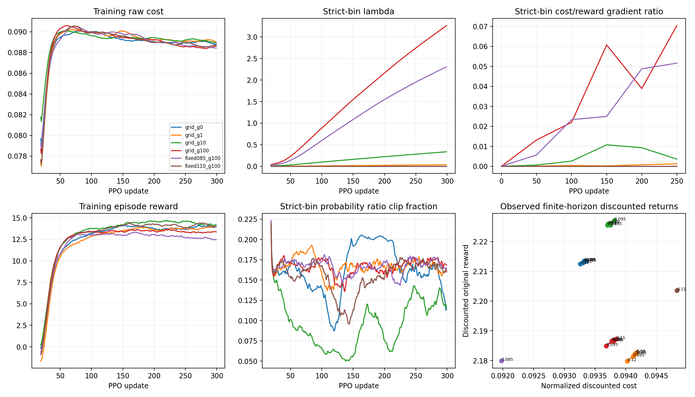

# Stage 1 constraint validation results

Status: **Complete pilot**.

All arms use the same trained HIM initialization and matched transitions. The original HIM, locomotion reward, cost, physics, GAE and combined-advantage semantics are preserved.

## Evaluation: command (1,0,0), seed 11

| Arm | Epsilon | Discounted cost | Violation | Raw cost | Return | Tracking error | Survival | Vc vs deployment RMSE |
| --- | ---: | ---: | ---: | ---: | ---: | ---: | ---: | ---: |
| grid_g0 | 0.080 | 0.093352 | 0.013352 | 0.091534 | 22.495 | 0.1556 | 87.26% | 0.006829 |
| grid_g0 | 0.085 | 0.093322 | 0.008322 | 0.091538 | 22.476 | 0.1558 | 87.13% | 0.006893 |
| grid_g0 | 0.095 | 0.093329 | 0.000000 | 0.091598 | 22.516 | 0.1553 | 87.74% | 0.006871 |
| grid_g0 | 0.110 | 0.093301 | 0.000000 | 0.091524 | 22.467 | 0.1565 | 87.11% | 0.006916 |
| grid_g0 | 0.120 | 0.093258 | 0.000000 | 0.091469 | 22.217 | 0.1634 | 86.62% | 0.007085 |
| grid_g1 | 0.080 | 0.094173 | 0.014173 | 0.091060 | 22.329 | 0.1741 | 89.72% | 0.006944 |
| grid_g1 | 0.085 | 0.094147 | 0.009147 | 0.091150 | 22.249 | 0.1736 | 89.60% | 0.007052 |
| grid_g1 | 0.095 | 0.094117 | 0.000000 | 0.091094 | 22.182 | 0.1751 | 88.38% | 0.007028 |
| grid_g1 | 0.110 | 0.094178 | 0.000000 | 0.091012 | 22.287 | 0.1749 | 89.77% | 0.006953 |
| grid_g1 | 0.120 | 0.094026 | 0.000000 | 0.090970 | 21.948 | 0.1804 | 88.77% | 0.007242 |
| grid_g10 | 0.080 | 0.093753 | 0.013753 | 0.091062 | 22.628 | 0.1534 | 88.79% | 0.006371 |
| grid_g10 | 0.085 | 0.093750 | 0.008750 | 0.091097 | 22.592 | 0.1532 | 88.13% | 0.006372 |
| grid_g10 | 0.095 | 0.093813 | 0.000000 | 0.091234 | 22.934 | 0.1442 | 88.99% | 0.006198 |
| grid_g10 | 0.110 | 0.093702 | 0.000000 | 0.091249 | 22.901 | 0.1442 | 88.82% | 0.006457 |
| grid_g10 | 0.120 | 0.093709 | 0.000000 | 0.091193 | 22.845 | 0.1458 | 89.16% | 0.006449 |
| grid_g100 | 0.080 | 0.093801 | 0.013801 | 0.090986 | 21.814 | 0.1616 | 83.96% | 0.007500 |
| grid_g100 | 0.085 | 0.093774 | 0.008774 | 0.091135 | 21.912 | 0.1599 | 83.96% | 0.007635 |
| grid_g100 | 0.095 | 0.093683 | 0.000000 | 0.090953 | 21.581 | 0.1675 | 83.94% | 0.007779 |
| grid_g100 | 0.110 | 0.093843 | 0.000000 | 0.090937 | 21.635 | 0.1687 | 83.74% | 0.007544 |
| grid_g100 | 0.120 | 0.093783 | 0.000000 | 0.091016 | 21.596 | 0.1660 | 83.84% | 0.007609 |
| fixed085_g100 | 0.085 | 0.091975 | 0.006975 | 0.088865 | 22.191 | 0.1716 | 88.18% | 0.006360 |
| fixed110_g100 | 0.110 | 0.094832 | 0.000000 | 0.091828 | 22.836 | 0.1527 | 90.21% | 0.007831 |

## Same-epsilon change relative to lambda-zero continuation

| Arm | Epsilon | Discounted cost reduction | Raw cost reduction | Survival change (pp) | Tracking error change | Pilot screen |
| --- | ---: | ---: | ---: | ---: | ---: | --- |
| grid_g1 | 0.08 | -0.88% | 0.52% | +2.47 | +11.86% | Not passed |
| grid_g1 | 0.085 | -0.88% | 0.42% | +2.47 | +11.45% | Not passed |
| grid_g1 | 0.095 | -0.84% | 0.55% | +0.63 | +12.79% | Not passed |
| grid_g1 | 0.11 | -0.94% | 0.56% | +2.66 | +11.80% | Not passed |
| grid_g1 | 0.12 | -0.82% | 0.54% | +2.15 | +10.35% | Not passed |
| grid_g10 | 0.08 | -0.43% | 0.52% | +1.54 | -1.43% | Not passed |
| grid_g10 | 0.085 | -0.46% | 0.48% | +1.00 | -1.66% | Not passed |
| grid_g10 | 0.095 | -0.52% | 0.40% | +1.25 | -7.12% | Not passed |
| grid_g10 | 0.11 | -0.43% | 0.30% | +1.71 | -7.84% | Not passed |
| grid_g10 | 0.12 | -0.48% | 0.30% | +2.54 | -10.78% | Not passed |
| grid_g100 | 0.08 | -0.48% | 0.60% | -3.30 | +3.87% | Not passed |
| grid_g100 | 0.085 | -0.48% | 0.44% | -3.17 | +2.64% | Not passed |
| grid_g100 | 0.095 | -0.38% | 0.70% | -3.81 | +7.86% | Not passed |
| grid_g100 | 0.11 | -0.58% | 0.64% | -3.37 | +7.81% | Not passed |
| grid_g100 | 0.12 | -0.56% | 0.50% | -2.78 | +1.57% | Not passed |
| fixed085_g100 | 0.085 | 1.44% | 2.92% | +1.05 | +10.15% | Not passed |
| fixed110_g100 | 0.11 | -1.64% | -0.33% | +3.10 | -2.42% | Not passed |

## Sampled physical diagnostics

| Arm | Epsilon | Force cost | Impact cost | Fz peak mean (N) | dF peak mean (N/s) | Base acceleration (m/s²) | Touchdowns per alive step |
| --- | ---: | ---: | ---: | ---: | ---: | ---: | ---: |
| grid_g0 | 0.080 | 0.062297 | 0.029237 | 73.14 | 1566.59 | 3.403 | 0.2115 |
| grid_g0 | 0.085 | 0.062265 | 0.029273 | 73.22 | 1569.65 | 3.413 | 0.2116 |
| grid_g0 | 0.095 | 0.062309 | 0.029289 | 73.25 | 1569.49 | 3.407 | 0.2118 |
| grid_g0 | 0.110 | 0.062267 | 0.029257 | 73.19 | 1569.39 | 3.409 | 0.2116 |
| grid_g0 | 0.120 | 0.062199 | 0.029270 | 73.46 | 1574.46 | 3.408 | 0.2113 |
| grid_g1 | 0.080 | 0.063375 | 0.027685 | 71.36 | 1475.22 | 3.288 | 0.2061 |
| grid_g1 | 0.085 | 0.063415 | 0.027735 | 71.38 | 1477.65 | 3.287 | 0.2063 |
| grid_g1 | 0.095 | 0.063391 | 0.027703 | 71.31 | 1476.21 | 3.284 | 0.2062 |
| grid_g1 | 0.110 | 0.063341 | 0.027671 | 71.33 | 1476.25 | 3.287 | 0.2059 |
| grid_g1 | 0.120 | 0.063219 | 0.027751 | 71.50 | 1482.99 | 3.281 | 0.2060 |
| grid_g10 | 0.080 | 0.061822 | 0.029240 | 73.64 | 1523.25 | 3.340 | 0.2055 |
| grid_g10 | 0.085 | 0.061820 | 0.029277 | 73.64 | 1521.39 | 3.336 | 0.2051 |
| grid_g10 | 0.095 | 0.061959 | 0.029275 | 73.47 | 1511.77 | 3.334 | 0.2050 |
| grid_g10 | 0.110 | 0.061974 | 0.029275 | 73.39 | 1513.35 | 3.334 | 0.2051 |
| grid_g10 | 0.120 | 0.061953 | 0.029241 | 73.36 | 1512.61 | 3.329 | 0.2052 |
| grid_g100 | 0.080 | 0.062515 | 0.028472 | 72.77 | 1548.78 | 3.363 | 0.2085 |
| grid_g100 | 0.085 | 0.062585 | 0.028549 | 72.91 | 1552.45 | 3.365 | 0.2087 |
| grid_g100 | 0.095 | 0.062415 | 0.028539 | 73.02 | 1557.65 | 3.365 | 0.2085 |
| grid_g100 | 0.110 | 0.062440 | 0.028496 | 73.05 | 1558.11 | 3.366 | 0.2083 |
| grid_g100 | 0.120 | 0.062413 | 0.028603 | 73.05 | 1559.02 | 3.364 | 0.2085 |
| fixed085_g100 | 0.085 | 0.061909 | 0.026956 | 72.62 | 1480.40 | 3.280 | 0.1973 |
| fixed110_g100 | 0.110 | 0.062445 | 0.029382 | 74.11 | 1534.64 | 3.303 | 0.2036 |

## Interpretation limits

- The screen is a declared pilot criterion, not a QuietPaw reproduction claim.
- Confidence intervals in the JSON describe paired environment outcomes at one trained seed. They do not quantify uncertainty across independent training runs.
- Fixed-budget arms receive more samples at their one condition. A difference from the grid arm does not uniquely identify a representation problem.
- Discounted reward/cost omit the evaluation-horizon tail; cost critic calibration uses those physical observed returns. Bootstrapped cost estimates are reported separately.
- The critic is trained for a stochastic Gaussian policy; deployment evaluation uses its deterministic mean action. Vc vs deployment RMSE therefore includes a policy mismatch and is not a pure critic calibration error for the training policy.
- Lower discounted cost accompanied by lower survival needs explicit failure analysis. Per-alive-step cost, contact events, tracking, forces, and return are recorded alongside it.
- 300 warm-start PPO updates do not establish convergence or infeasibility of a budget.

- Force peaks are sampled at the 50-Hz control rate. The proxy is not an acoustic measurement, and per-foot monotonicity does not guarantee monotonicity of aggregate force cost under changes in contact count.

Protocol: [quietpaw_constraint_validation_protocol.md](./quietpaw_constraint_validation_protocol.md).
Machine-readable results: [quietpaw_constraint_validation.json](./quietpaw_constraint_validation.json).
