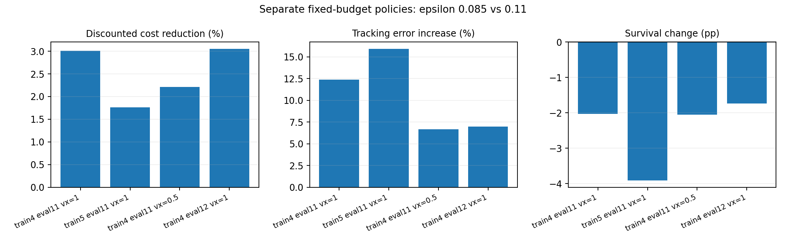

# Stage 1 约束验证：结论与下一步

状态：**已完成 6 组主实验、2 组独立微调 seed 确认，以及额外评估。Stage 2 未实施。**

所有训练均从同一个已训练 7500 轮的 HIM checkpoint 开始；每组 4096 环境、300 次 PPO 更新、122,880,000 transitions。合计 983,040,000 transitions。初始网络 tensor hash 一致；配对评估的初始状态和环境配置 hash 一致。没有从头学习基本运动能力的混淆。

## 1. 可以确认什么

- 增加 PID 增益后，lambda 加权的 cost 对 actor 梯度的相对贡献上升。仅提高增益，尚未在混合 ε 的部署 sweep 中产生有效、方向清晰的静音控制。
- 主实验没有任何组通过预先声明的同 ε、lambda=0 对照筛选：折扣成本降低至少 3%，存活率下降不超过 5 个百分点，tracking error 增加不超过 15%，且每存活步成本下降。
- 固定严格预算与固定宽松预算的成本下降方向在两个独立微调 seed 中重复出现。两组共享原始 HIM 预训练 checkpoint，不能称为完整训练全过程的独立重复；也未训练同一固定 ε=0.085 的 lambda=0 对照，不能把该固定预算差异完全归因于约束项。

### 约束梯度诊断

| 微调 seed | 策略 | 末 50 轮严格 bin 的 lambda 均值 | 第 250 轮 actor cost/reward 梯度范数比 |
| ---: | --- | ---: | ---: |
| 4 | grid_g0 | 0.0000 | 0.00% |
| 4 | grid_g1 | 0.0325 | 0.12% |
| 4 | grid_g10 | 0.3191 | 0.36% |
| 4 | grid_g100 | 3.1053 | 7.04% |
| 4 | fixed085_g100 | 2.1987 | 5.16% |
| 4 | fixed110_g100 | 0.0000 | 0.00% |
| 5 | fixed085_g100 | 2.0245 | 2.27% |
| 5 | fixed110_g100 | 0.0000 | 0.00% |

grid 的严格 bin 为最低 ε bin，fixed 的 bin 包含全部环境。梯度比是一次有限 rollout 样本探针，包含 lambda/(1+lambda) 权重，未包含 entropy 或 value loss；它不代表完整优化器位移，也不是 50 轮梯度的平均值。HIM 辅助更新保持每轮 20 次。

## 2. 固定预算对照

下面的严格组为 ε=0.085，宽松组为 ε=0.11，PID 增益相同。它们是两套分别训练的策略，**不是同一策略切换 ε 的 Pareto sweep**。后续评估和 seed 5 确认是在主实验结果出现后选择的探索性检查。

| 微调 seed | 评估 seed | vx command | 折扣成本下降 | 每存活步成本下降 | tracking error 增加 | 存活率变化 | 严格组超预算量 |
| ---: | ---: | ---: | ---: | ---: | ---: | ---: | ---: |
| 4 | 11 | 1 | 3.01% | 3.23% | +12.39% | -2.03 pp | 0.006975 |
| 5 | 11 | 1 | 1.77% | 1.15% | +15.91% | -3.91 pp | 0.007310 |
| 4 | 11 | 0.5 | 2.21% | 2.08% | +6.69% | -2.05 pp | 0.002457 |
| 4 | 12 | 1 | 3.05% | 3.13% | +7.00% | -1.73 pp | 0.007052 |

成本下降必须与 tracking、每存活步 reward 和存活率一起解释。每存活步成本也下降，说明总成本差异并非只能由更早失败解释；这仍不等于证明更安静的触地或声学降噪。

### 提前失败的描述性检查

| 微调 seed | 评估 seed | vx command | 两策略均存活的配对环境数 | 该子集折扣成本下降 |
| ---: | ---: | ---: | ---: | ---: |
| 4 | 11 | 1 | 3426 / 4096 | 2.97% |
| 5 | 11 | 1 | 3010 / 4096 | 1.53% |
| 4 | 11 | 0.5 | 3967 / 4096 | 2.19% |
| 4 | 12 | 1 | 3432 / 4096 | 2.94% |

该子集由两策略的存活结果共同选择，仅用于检查成本下降是否只能由提前终止造成；它不是总体因果效应，也不替代全部环境的主指标或筛选标准。

### 物理代理分解：command (1,0,0)、评估 seed 11

| 微调 seed | 策略 | 力成本 | 触地速度成本 | 每存活步触地事件 | 采样触地速度峰值均值 (m/s) | 采样 Fz 峰值均值 (N) | 采样 dF 峰值均值 (N/s) |
| ---: | --- | ---: | ---: | ---: | ---: | ---: | ---: |
| 4 | fixed085_g100 | 0.061909 | 0.026956 | 0.19732 | 0.24125 | 72.62 | 1480.40 |
| 4 | fixed110_g100 | 0.062445 | 0.029382 | 0.20359 | 0.25914 | 74.11 | 1534.64 |
| 5 | fixed085_g100 | 0.062113 | 0.029225 | 0.21232 | 0.27597 | 72.21 | 1568.71 |
| 5 | fixed110_g100 | 0.062150 | 0.030247 | 0.21061 | 0.26491 | 72.82 | 1555.85 |

力项与触地速度项包含既有 0.2/0.8 权重；频率是每控制步的四脚事件总数。采样触地速度峰值在没有触地的控制步为零，再按每存活步平均，因此也受接触频率影响；它不是仅对实际触地事件求平均的速度。成本下降可能同时来自降低接触频率和改变每次接触，不能只凭触地速度成本推断每次触地速度的变化。

seed 5 严格组虽然触地速度成本降低约 3.38%，但采样触地速度峰值指标上升约 4.17%，dF 峰值指标上升约 0.83%，base acceleration 指标上升约 2.65%。这些指标使用不同聚合方式，并不必然同向；当前结果不能称为所有冲击指标都改善，更不能仅凭 proxy 下降宣称真实降噪。

## 3. 仍未解决的研究问题

- 所有严格组部署评估仍超过 ε=0.085。300 轮 warm-start 微调既不能证明预算不可行，也不能证明算法已经收敛。
- 混合 ε 策略的成本曲线几乎平坦；当前不足以声称形成可控的噪声与性能 Pareto frontier。
- 当前力成本包含支持力，且采用凹变换及固定四脚分母。减少接触脚数可能降低总力成本，同时增加单脚力峰值。这是代理的数学性质，不是 PPO 符号错误；尚未证明策略实际利用了它。
- 物理诊断的力峰值采样率为 50 Hz，不能代表全部碰撞峰值；noise proxy 不是声压测量。
- critic 在随机高斯策略下训练，而部署评估使用均值动作。Vc 与部署 return 的 RMSE 包含策略不匹配和采样方差，不能单独归因于 critic 训练误差。
- ε 比较的是 `(1-gamma) * sum(gamma**t * cost_t)`。每存活步平均成本低于 ε 不能替代折扣预算判定；所有成本比较保持同一物理定义。

## 4. 后续实验数量与决策

本轮验证的训练矩阵已经完成，不再自动追加实验。对于是否推进 Stage 2，结论是：

- 固定预算成本下降方向已跨微调 seed 重复，可将 Stage 2 作为检验表示作用的受控实验；不能预先把新表示解释为改进。
- 若优先确认约束项本身的因果效果，可补 **2 组**固定 ε=0.085、lambda=0 的匹配控制（seed 4/5），与已有严格组对比。这个检查与 Stage 2 表示比较回答不同问题，不应混为同一结果。
- 如果开展 Stage 2 的初筛，建议 2 种 critic（现有 concat / 论文因子化 value）×2 个微调 seed，共 **4 组等 transitions 训练**。预算范围、PID、noise cost 与所有 HIM/机器人设置固定。
- 正式论文级别的比较至少扩展至同一矩阵的 3 个 seed，即 **6 组训练**，并进行 commands、terrain cohorts 的部署评估。这个数量是最低设计建议，不是达到复现成功的保证。
- 如果先修改支持力成本，应把成本定义作为单独对照；不能同时修改成本和 SF critic 后把差异归因于 SF。上述 4/6 组数字不包含新成本的验证。

## 5. 关键数据与限制

| 微调 seed | 策略 | ε | 折扣成本 | 每存活步成本 | 原 locomotion return | 每存活步 reward | tracking error | 存活率 |
| ---: | --- | ---: | ---: | ---: | ---: | ---: | ---: | ---: |
| 4 | fixed085_g100 | 0.085 | 0.091975 | 0.088865 | 22.1907 | 0.023373 | 0.17158 | 88.18% |
| 4 | fixed110_g100 | 0.110 | 0.094832 | 0.091828 | 22.8356 | 0.023769 | 0.15266 | 90.21% |
| 5 | fixed085_g100 | 0.085 | 0.092310 | 0.091338 | 21.1463 | 0.023607 | 0.16251 | 78.39% |
| 5 | fixed110_g100 | 0.110 | 0.093970 | 0.092397 | 22.0445 | 0.024060 | 0.14020 | 82.30% |

环境配对置信区间保存在 JSON 中，只描述给定训练 checkpoint 下的配对环境结果，不能用 4096 个环境替代独立训练 seed 的统计不确定性。两次独立微调也不足以稳定估计跨训练 seed 的总体方差。

## 文件

- [主实验完整数据](./quietpaw_constraint_validation.md)
- [实验协议、冻结内容与复现命令](./quietpaw_constraint_validation_protocol.md)
- [支持力代理算例](./quietpaw_force_proxy_support_diagnostic.md)
- [合并结果 JSON](./quietpaw_constraint_validation_findings.json)
- [seed 5 明细](./quietpaw_constraint_validation_seed5.md)

当前代码及分析脚本的完成后快照保存在主实验日志目录的 `source_snapshot_after_validation.tar.gz`，SHA-256 与 package versions 见同目录 `source_snapshot_record.json`。训练前后哈希核对覆盖实验 manifest 列出的文件；该归档本身是实验完成后保存的快照。
