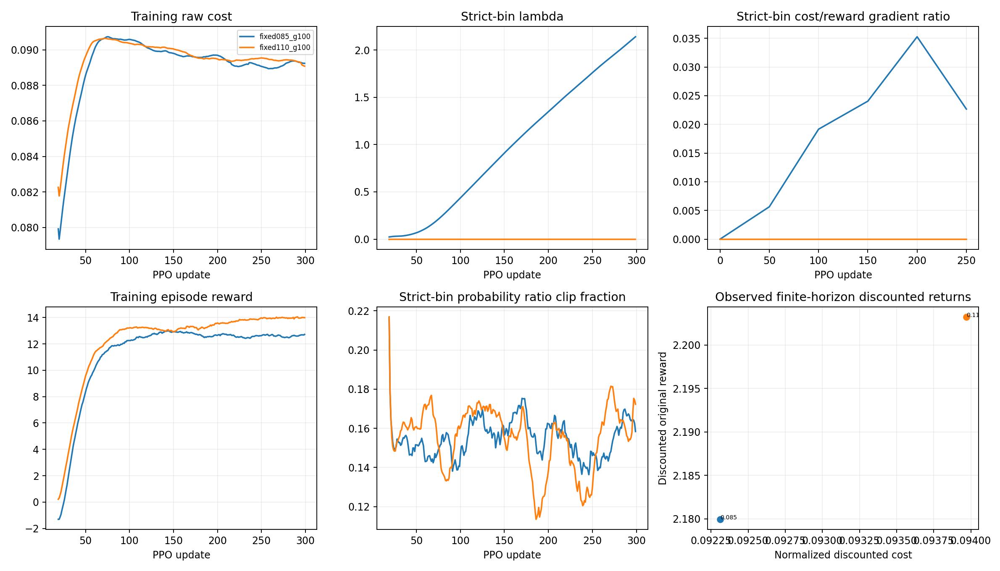

# Stage 1 constraint validation results

Status: **Complete pilot**.

All arms use the same trained HIM initialization and matched transitions. The original HIM, locomotion reward, cost, physics, GAE and combined-advantage semantics are preserved.

## Evaluation: command (1,0,0), seed 11

| Arm | Epsilon | Discounted cost | Violation | Raw cost | Return | Tracking error | Survival | Vc vs deployment RMSE |
| --- | ---: | ---: | ---: | ---: | ---: | ---: | ---: | ---: |
| fixed085_g100 | 0.085 | 0.092310 | 0.007310 | 0.091338 | 21.146 | 0.1625 | 78.39% | 0.008028 |
| fixed110_g100 | 0.110 | 0.093970 | 0.000000 | 0.092397 | 22.045 | 0.1402 | 82.30% | 0.007523 |

## Same-epsilon change relative to lambda-zero continuation

| Arm | Epsilon | Discounted cost reduction | Raw cost reduction | Survival change (pp) | Tracking error change | Pilot screen |
| --- | ---: | ---: | ---: | ---: | ---: | --- |

## Sampled physical diagnostics

| Arm | Epsilon | Force cost | Impact cost | Fz peak mean (N) | dF peak mean (N/s) | Base acceleration (m/s²) | Touchdowns per alive step |
| --- | ---: | ---: | ---: | ---: | ---: | ---: | ---: |
| fixed085_g100 | 0.085 | 0.062113 | 0.029225 | 72.21 | 1568.71 | 3.486 | 0.2123 |
| fixed110_g100 | 0.110 | 0.062150 | 0.030247 | 72.82 | 1555.85 | 3.395 | 0.2106 |

## Interpretation limits

- The screen is a declared pilot criterion, not a QuietPaw reproduction claim.
- Confidence intervals in the JSON describe paired environment outcomes at one trained seed. They do not quantify uncertainty across independent training runs.
- Fixed-budget arms receive more samples at their one condition. A difference from the grid arm does not uniquely identify a representation problem.
- Discounted reward/cost omit the evaluation-horizon tail; cost critic calibration uses those physical observed returns. Bootstrapped cost estimates are reported separately.
- The critic is trained for a stochastic Gaussian policy; deployment evaluation uses its deterministic mean action. Vc vs deployment RMSE therefore includes a policy mismatch and is not a pure critic calibration error for the training policy.
- Lower discounted cost accompanied by lower survival needs explicit failure analysis. Per-alive-step cost, contact events, tracking, forces, and return are recorded alongside it.
- 300 warm-start PPO updates do not establish convergence or infeasibility of a budget.

- Force peaks are sampled at the 50-Hz control rate. The proxy is not an acoustic measurement, and per-foot monotonicity does not guarantee monotonicity of aggregate force cost under changes in contact count.

Protocol: [quietpaw_constraint_validation_protocol.md](./quietpaw_constraint_validation_protocol.md).
Machine-readable results: [quietpaw_constraint_validation_seed5.json](./quietpaw_constraint_validation_seed5.json).
