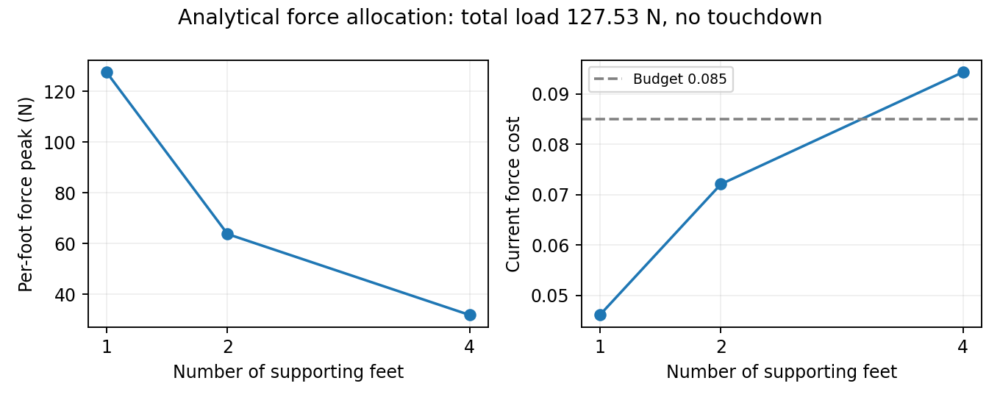

# 当前力成本的支持力算例

这是验证过程中追加的公式诊断，没有修改训练成本，也不是机器人 rollout 或声学测量。

当前力成本是

\[
c_F=\frac{0.2}{4}\sum_i \mathbf{1}_{\|F_i\|>1}\left(1-e^{-\|F_i\|/50}\right).
\]

固定总垂直支持力为 127.53 N（**算例假设**质量 13 kg），均匀分配到不同数量的脚上，令速度为零且没有新的触地事件。实际调用当前 `noise_cost_components()` 得到：

| 支撑脚数 | 单脚力峰值（N） | 力成本 | 触地速度成本 |
| --- | ---: | ---: | ---: |
| 4 | 31.88 | 0.094293 | 0 |
| 2 | 63.76 | 0.072065 | 0 |
| 1 | 127.53 | 0.046098 | 0 |

这证明两点：

1. 静态支持力产生非零成本。对于算例中的四脚均匀支持，成本本身已高于预算 0.085，即使没有触地冲击。
2. 减少支撑脚数量时，单脚力峰值上升，总力成本反而下降。原因是 `1-exp(-F/50)` 为凹函数，且四脚平均的分母固定。

因此，单脚力增加会使该脚的成本增加，但**不能据此保证跨步态的总成本与冲击强度同向变化**。这不是 PPO 符号错误；它是当前物理代理的性质。此算例也不能证明训练中的机器人已经利用了这个性质，或证明单脚静态支持是可执行的稳定姿态。

本轮 PID/固定预算对照继续保留该成本。解释结果时应同时报告力峰值、触地速度项、接触频率、存活率和 tracking。若之后采用此前讨论的“正常支持力以上的冲击部分”作为力成本，应单独定义和验证，不应混入 SF critic 对照，也不能未经作者代码验证就称为原文公式的等价实现。

数值原始文件：[quietpaw_force_proxy_support_diagnostic.json](./quietpaw_force_proxy_support_diagnostic.json)。
