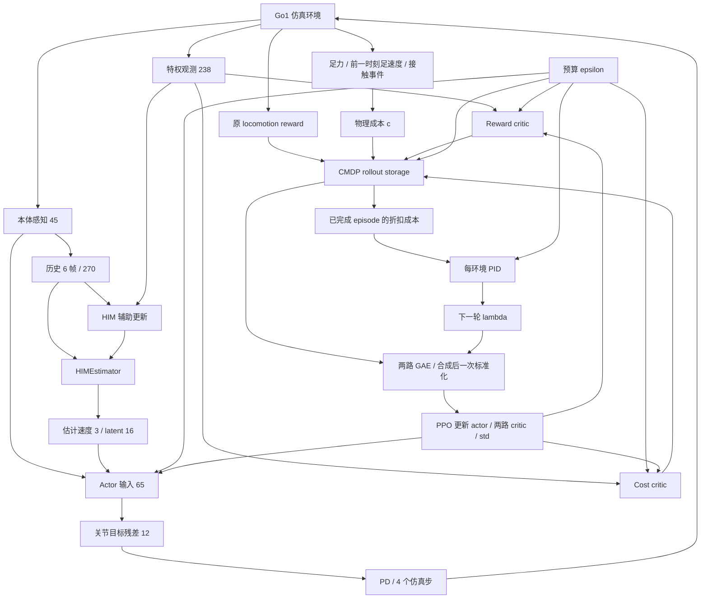
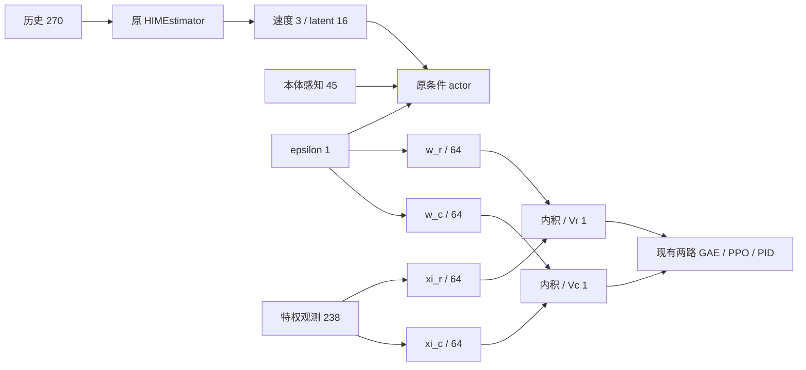

# HIMLoco + QuietPaw：Stage 2 前项目状态报告

## 0. 文档控制

| 项目 | 内容 |
| --- | --- |
| 报告日期 | 2026-10-07，Asia/Shanghai |
| 项目目录 | `/home/sjc/HIMLoco-Go1` |
| 当前分支 | `quietpaw-him-warmstart` |
| 当前 HEAD | `1fc33c65687f72d9ff4e50d002199d59a1d66800` |
| 早期实验分支 | `quietpaw-reproduction` |
| 当前阶段 | Stage 1 已实施。Stage 2 未实施。 |
| 本次工作 | 读取代码、论文、实验记录和产物。新增本报告。 |
| 本次未执行的工作 | 未修改算法。未训练模型。未重新运行回归测试。 |

**版本说明：当前工作区存在未提交修改和未跟踪文件。HEAD 不能独立标识当前算法。**

当前 63 个仓库 Python 文件与 10 月 2 日完成后归档快照一致。两个约束实验清单列出的 14 个冻结文件也与当前文件一致。归档包含另外 3 个临时分析脚本。归档本身在实验结束后创建，不能据此声称全部文件在训练前均已冻结。

报告编写前，已有 11 个 tracked 文件处于修改状态。它们涉及 Stage 1 文档、配置、成本环境、训练与评估入口、ε 分配、PPO、runner、评估工具和修正测试。近期分析文件、约束验证脚本、梯度诊断模块和相应测试仍为 untracked。以上状态属于已有工作，不是本次报告造成的代码修改。

### 0.1 中文写作规则

ASD-STE100 包含英语写作规则和受控英语词典。本报告采用其写作原则编写中文。中文不能直接接受该英语词典的合规检查。本报告不声明正式的 ASD-STE100 合规认证。[ASD 官方说明](https://www.asd-ste100.org/STE_faq.html)

本报告使用以下规则：

1. 一个句子说明一个主要事项。
2. 同一对象使用同一术语。
3. 操作步骤明确给出对象和动作。
4. 数值注明单位、条件和来源。
5. 事实、推断、假设和建议分别说明。
6. 未解决的问题保留“未决”状态。

### 0.2 阅读顺序

首次接手项目时，先读第 1、2、8、9、12 节。

定位算法时，读第 3 至 6 节和第 14 节。

配置 Stage 2 时，读第 7、10、11 节。

复查实验时，读第 8、13、15 节。

---

## 1. 当前结论

**Stage 1 已形成可运行、可保存、可恢复的 HIMLoco CMDP 训练链路。当前尚未证明同一策略具备有用的 ε 静音控制，也未复现 QuietPaw 的 Pareto frontier。**

| 判断对象 | 当前状态 | 证据与限制 |
| --- | --- | --- |
| HIM 运动骨干 | 已保留 | 已训练 HIM 权重初始化后的完整 4000 轮训练保留了运动能力。 |
| Actor 的 ε 输入 | 已实施 | Actor 接收本体感知、HIM 输出和 ε。实测动作对 ε 有响应。 |
| HIM 梯度边界 | 已检查 | 历史测试检查了 PPO 梯度隔离。当前代码保留运行时检查。 |
| 双 critic、双 GAE、PID | 已实施并有诊断证据 | 增加 PID 增益后，成本梯度的相对贡献增加。 |
| 固定严格预算的成本下降 | 有初步证据 | 两个微调 seed 均观察到下降。缺少同一固定 ε 的 λ=0 对照。 |
| 混合 ε 的部署控制 | 未验证成功 | 当前成本曲线接近平坦。主实验没有组通过预先定义的筛选。 |
| 严格预算满足 | 未验证成功 | ε=0.085 的固定策略仍超预算。 |
| 真实声学降噪 | 未验证 | 当前只使用物理代理。没有声压测量。 |
| Stage 2 因子化 value | 尚未实施 | 本报告给出实施边界和对照条件。 |

### 1.1 对早期结论的修正

早期 100 轮从零训练的 ε sweep 显示了条件敏感性。但是策略没有学会基本的速度跟踪。该结果不能证明“ε-conditioned locomotion 已验证”。后续报告已增加有效性修正。

7500 轮 HIM 初始化后的完整 4000 轮实验解决了“策略不会走”的主要混淆。但是该实验仍未产生有用的条件静音行为。

后续 8 组诊断表明约束链路有作用。该结果没有证明算法收敛，也没有证明成本定义足以代表真实噪声。

### 1.2 Stage 2 决策

**可以将 Stage 2 作为论文组件的受控结构复现实验。不能把 Stage 1 标记为复现成功后直接开展改进实验。**

Stage 2 前需明确 critic 初始化方案、未报告的网络设置、对照矩阵和主指标。成本定义与 critic 表示应分开实验。

证据汇总见[约束验证结论](./quietpaw_constraint_validation_findings.md)。

---

## 2. 研究目标与实施边界

### 2.1 研究问题

本项目检验 QuietPaw 的噪声约束框架能否迁移到 HIMLoco 盲行走骨干。

目标包括：

- 保留可用的速度跟踪和存活能力。
- 在同一策略中通过 ε 调整成本与运动性能。
- 在统一评估条件下测量预算违反和 Pareto trade-off。
- 将论文可确定的设计与本地复现假设分别记录。

本项目当前未使用可验证的作者训练实现。早期检索没有找到该实现。该记录不能证明截至报告日期所有网站都没有作者代码。

### 2.2 当前保留的 HIM 组件

| 组件 | 当前处理 |
| --- | --- |
| 45 维单帧本体感知 | 保留 |
| 6 帧历史和固定观测缩放 | 保留 |
| HIMEstimator 网络和辅助损失 | 保留 |
| HIMEstimator 辅助更新 | 保留，每轮 20 次 |
| 原 HIM actor 隐藏层 | 保留，新增一个 ε 输入 |
| 原 HIM PPO 文件 | 保留，Stage 1 使用独立扩展类 |
| 原 Go1 reward | 保留，不把成本从 reward 中扣除 |
| Go1、动作空间、PD、仿真 | 保留 |
| 地形和域随机化 | 保留 |

“保留 HIM”指保留设计和学习规则。HIM 参数在 Stage 1 仍继续学习。

Stage 1 修正了其两路 critic 的 timeout bootstrap。原 HIM PPO 文件未修改。因此，不能把 Stage 1 的 timeout return 与原 HIM 实现表述为完全相同。

### 2.3 当前与原论文的关系

本项目是**在 HIMLoco 上迁移论文框架的复现**。机器人、reward 和训练初始化存在有意保留的骨干差异。

Stage 1 使用直接拼接条件的双 critic。其结构接近论文的直接条件基线。当前不应称其为完整 CNCP。

Stage 2 计划加入论文公式 (6)/(7) 的 value 因子化。完整论文结果还涉及评估设计与硬件测量，不能仅靠新增网络声明完成复现。

---

## 3. 术语、张量与部署信息

### 3.1 统一术语

| 术语 | 本报告中的含义 |
| --- | --- |
| ε | 实际的归一化折扣成本预算，也是 actor 和 critic 的条件输入 |
| 原始成本 `c` | 每个控制步采样的物理噪声代理，范围为 `[0,1]` |
| 归一化折扣成本 `J_c` | `(1−γ) Σ γ^t c_t` 的期望或观测估计 |
| 原 locomotion reward | HIM 环境产生的原始运动 reward |
| PID λ | 每个环境独立的非负 Lagrange multiplier |
| GAE 参数 | 当前为 0.95，与 PID λ 不同 |
| 微调 seed | 从同一 HIM checkpoint 开始的训练随机种子 |
| 评估 seed | 评估初始化随机种子，不是独立训练重复 |
| 存活率 | 首次 episode 存活到评估时域终点的比例 |
| 每存活步指标 | 首次 episode 有效步骤内的平均值 |
| 采样峰值 | 控制时刻采样后对脚取最大，再按指定方式汇总 |
| 论文所称 SF 表示 | 状态特征与 ε 权重的内积 value 表示 |

### 3.2 当前张量接口

设批量大小为 `B`。训练 rollout 为 `T=100`，环境数通常为 `N=4096`。

| 张量 | 形状 | 内容 |
| --- | --- | --- |
| 单帧本体感知 `o` | `[B,45]` | 命令 3、基座角速度 3、投影重力 3、关节位置偏差 12、关节速度 12、上次动作 12 |
| 历史 `h` | `[B,270]` | 6 帧本体感知，最新帧位于前部 |
| 特权观测 `s_p` | `[B,238]` | 本体感知 45、基座线速度 3、外力 3、地形高度 187 |
| HIM 估计速度 | `[B,3]` | 从历史预测的基座线速度 |
| HIM latent `z` | `[B,16]` | 经过 L2 归一化的内部表示 |
| ε | `[B,1]` | 预算条件 |
| Actor 输入 | `[B,65]` | `45+3+16+1` |
| 每路 Stage 1 critic 输入 | `[B,239]` | `238+1` |
| 动作 `a` | `[B,12]` | 12 个关节目标位置残差 |
| `V_r`、`V_c` | 各 `[B,1]` | 两路 scalar value |
| reward/cost return 与 advantage | 各 `[T,N,1]` | 两路目标和两路优势，随后生成合成优势 |

地形高度点数为 **187**。不能用 196 计算当前 critic 输入。

### 3.3 信息可用性

| 信息 | 训练可用 | 部署可用 | 当前用途 |
| --- | --- | --- | --- |
| 关节位置、关节速度、IMU | 是 | 是 | 单帧观测、历史、actor |
| 速度命令、上次动作 | 是 | 是 | 单帧观测、历史、actor |
| ε | 是 | 是 | Actor、两路 critic、storage、PID 比较 |
| 历史本体感知 | 是 | 是 | HIMEstimator |
| HIM 估计速度和 latent | 是 | 是 | Actor |
| 真实基座线速度 | 是 | 当前 actor 不使用 | Critic、HIM 辅助监督、评估 |
| 地形高度、外力 | 是 | 当前 actor 不使用 | Critic |
| 足接触力和足速度 | 是 | 当前部署 actor 不使用 | 成本、物理诊断 |
| 摩擦、质量、PD 随机化参数 | 仿真存在 | 通常不可直接获得 | 环境动力学；不直接拼接到当前 238 维 critic |
| 声压、声学频谱 | 否 | 未接入 | 当前无此模型 |

“盲行走”指部署策略没有地形高度或其他外部地形感知。它仍使用本体感知和历史推断。

特权信息也用于 HIM 的辅助监督。因此，准确表述是“actor 不直接接收特权信息”，而不是“特权信息仅给 critic”。

---

## 4. 当前架构与更新边界

### 4.1 完整信息流



图中的 `lambda` 指向下一轮合成优势。当前 rollout 的优势使用更新前的 multiplier。

### 4.2 网络

| 网络 | 结构 | 优化方式 |
| --- | --- | --- |
| Actor | `65→512→256→128→12`，隐藏层 ELU | PPO Adam |
| Reward critic | `239→512→256→128→1`，隐藏层 ELU | PPO Adam |
| Cost critic | 同 reward critic，参数独立 | PPO Adam |
| HIM encoder | `270→128→64→19` | HIM 独立 Adam |
| HIM target 网络 | `45→128→64→16` | HIM 独立 Adam |
| HIM prototypes | `32×16` | HIM 独立 Adam |
| 动作标准差 | 12 个可训练参数 | PPO Adam |

HIM encoder 的 19 维输出分为 3 维速度和 16 维 latent。辅助损失包含速度 MSE 与原有表示学习损失。当前 temperature 为 3，Sinkhorn 参数为 0.05 和 3 次迭代。

速度监督使用 `next_critic_obs[:,45:48]`。Target 网络的 45 维输入使用 `next_critic_obs[:,3:48]`。后者移除了前三维命令，并包含真实速度三维。它不是直接取下一帧本体感知的前 45 维。当前保留这个原 HIM 切片。Stage 2 不应顺带修改它。

### 4.3 梯度边界

Actor 使用 HIM 输出时，HIM 输出与 PPO 计算图断开。Cost loss 只更新 cost critic。Reward value loss 只更新 reward critic。

PPO optimizer 的参数列表可能包含 estimator 参数。但是 PPO backward 后这些参数的梯度必须为 `None`。代码对此执行检查。不能仅查看 optimizer 参数列表就判断 HIM 被 PPO 更新。

每个 PPO minibatch 按以下顺序更新：

1. 计算 actor 与两路 critic 输出。
2. 用历史与下一状态特权观测执行一次 HIM 辅助更新。
3. 合成 policy、reward value、cost value 和 entropy loss。
4. 清除 PPO optimizer 梯度。
5. 执行 `loss.backward()`。
6. 检查 HIM 没有 PPO 梯度。
7. 裁剪梯度并执行 PPO `optimizer.step()`。

HIM 辅助 optimizer 使用单独的 backward 和 step。辅助学习率随 PPO 自适应学习率同步。

### 4.4 可训练参数与非梯度状态

**可训练参数：** actor 所有层、动作标准差、reward critic 所有层、cost critic 所有层、HIM encoder、HIM target 网络、HIM prototypes。

**非梯度状态：** PID multiplier、积分项、平滑项、更新计数、ε 分配、episode 成本累加器。PID 不接受 autograd 更新。

---

## 5. 成本、预算与 PPO-Lagrangian

### 5.1 当前成本的完整定义

对第 `i` 个脚，定义：

\[
F_i=\|\mathbf F_i\|_2,\qquad m_i=\mathbf1[F_i>1\ \mathrm N].
\]

\[
d_i=m_i\land\neg m_{i,\mathrm{previous}}\land\mathrm{valid},\qquad
v_i=\max(-v_{z,i,\mathrm{previous}},0).
\]

\[
c_F=\frac{0.2}{4}\sum_{i=1}^{4}m_i\left(1-e^{-F_i/50}\right),
\qquad
c_I=\frac{0.8}{4}\sum_{i=1}^{4}d_i\left(1-e^{-v_i^2/0.5}\right).
\]

\[
c=c_F+c_I\in[0,1].
\]

力单位为 N。速度单位为 m/s。速度尺度作用于速度平方。力采用世界坐标三维向量的模，速度采用世界坐标竖直分量。

ε 不进入该函数。改变 ε 不会直接改变同一物理状态的 `c`。

### 5.2 采样时序

成本在动作后的物理状态采样。采样发生在 reset 前。控制周期为 0.02 s，即 50 Hz。每个动作包含 4 个 0.005 s 仿真步。

触地速度使用前一个控制时刻的下降速度。该处理避免直接把碰撞后已经减速的足速度作为碰撞前速度。但是它不能精确恢复两个控制时刻之间的连续触地速度。

Reset 清除接触和速度历史，并将有效标记设为假。首次采样不产生触地速度成本。力成本仍可在首次采样产生。终止步成本在 reset 前保存。

当前没有按物理子步记录全部冲击峰值。50 Hz 指标不能代表 200 Hz 物理过程的最大峰值。

### 5.3 当前预算单位

训练使用：

\[
\widetilde c_t=(1-\gamma)c_t,\qquad
J_c^\pi=\mathbb E\left[(1-\gamma)\sum_{t\geq0}\gamma^t c_t\right],\qquad\gamma=0.99.
\]

PID 将上述 `J_c` 与 ε 比较。Actor 和 critic 输入同一个 ε。当前没有额外 ε 映射。

论文公式 (3) 写的是未乘 `(1−γ)` 的折扣累计量。当前的 return 缩放是本地预算单位选择。作者训练实现是否采用相同缩放仍未确定。[QuietPaw 方法定义](https://arxiv.org/html/2503.05035v1#S3)

若使用未归一化成本预算，严格等价需要同时转换预算：

\[
J_c^{\mathrm{normalized}}=(1-\gamma)J_c^{\mathrm{unscaled}},\qquad
\epsilon_{\mathrm{normalized}}=(1-\gamma)\epsilon_{\mathrm{unscaled}}.
\]

不能在只缩放 return 的情况下宣称相同数值 ε 与作者完全等价。

每存活步平均成本与折扣成本不是同一指标。一个指标低于 ε 不代表另一指标满足预算。

在 0.02 s 控制周期和 γ=0.99 下，折扣权重的时间常数约为 1.99 s。约 95% 的权重位于前 6 s。20 s 评估的折扣成本与整段每步平均会有不同的时间侧重。

评估的观测折扣成本不包含时域外尾项。1000 步时，若 `c≤1`，归一化尾项上界约为 `γ^1000=0.0000432`。更早真实失败按当前 episodic 定义截断。

### 5.4 ε=0、小 ε 和默认范围

成本非负。ε=0 要求所计入轨迹的成本几乎处处为零。存在正常足支持力时，当前力成本为正。因此，持续正常站立或运动很难满足零预算。

这不构成所有步态的严格正下界证明。失败截断、接触脚数和时序都会改变折扣成本。当前也未证明 ε=0.08 或 0.085 对稳定运动不可行。

更小 ε 会增加超预算误差，可能提高 PID λ。它也可能导致 tracking 下降、失败增加或 multiplier 持续增长。更强约束压力不保证更低真实噪声。

当前默认 ε 为 `[0.2,1]`。现有稳定策略的折扣成本约为 0.09。因此该默认范围通常不激活约束。ε=1 对当前有界归一化成本本身是宽松上界。

`[0.08,0.12]` 是诊断约束活跃区间。它不是 ε 的新映射，也不是论文已报告的最优区间。

### 5.5 两路 GAE 和 policy loss

Reward 与 cost 独立计算 GAE。Reward 使用原环境 reward。Cost 使用 `\widetilde c`。

\[
A_{\mathrm{combined},t}^{i}=\frac{A_{r,t}^{i}-\lambda_i A_{c,t}^{i}}{1+\lambda_i}.
\]

代码先恢复原始 reward advantage。随后合成两路优势。最后只对整个 rollout 的合成优势执行一次标准化。

PPO 使用标准 clipped surrogate 的最小化形式。成本优势前为负号。正的成本优势会降低动作在合成目标中的价值。当前没有发现“成本越大，惩罚反而越小”的 PPO 符号问题。

总 loss 为：

\[
L=L_{\mathrm{policy}}+L_{V_r}+L_{V_c}-0.01H(\pi).
\]

两路 value loss 当前系数均为 1。Value clipping 沿用现有 PPO 设置。

### 5.6 Timeout 与真实失败

| 情况 | Reward target | Cost target |
| --- | --- | --- |
| 普通非终止步 | 正常下一状态 bootstrap | 正常下一状态 bootstrap |
| Timeout | `r+γ V_r(s_terminal,ε)` | `(1−γ)c+γ V_c(s_terminal,ε)` |
| 真实物理失败 | 无 terminal bootstrap | 无 terminal bootstrap |
| Timeout 与失败同时为真 | 按真实失败处理 | 按真实失败处理 |

`s_terminal` 为动作后、reset 前的特权观测。Runner 恢复该观测后送入算法。旧 `V(s_t)` 仍保存在 storage，用于 GAE 和 value clipping。

Done 标记切断跨 episode 的 GAE。Reset 后的新状态不能用于上一条终止 transition 的 bootstrap。

### 5.7 PID 更新规则

每个环境维护独立 PID。只有该环境在当前收集周期完成了新 episode，PID 才更新。

设有效 episode 的测量成本为 `C_i`，误差为 `e_i=C_i−ε_i`。当前规则为：

\[
I_i^+=\max(0,I_i+k_I e_i),\qquad P_i^+=\beta P_i+(1-\beta)e_i.
\]

\[
\bar C_i^+=\beta\bar C_i+(1-\beta)C_i,\qquad
D_i=\max(0,\bar C_i^+-\bar C_i).
\]

\[
\lambda_i^+=\max(0,I_i^++k_P P_i^++k_D D_i).
\]

默认 `β=0.95`。当前没有 λ 上限。PPO 使用旧 λ；PID 在当前 PPO 更新结束后计算下一轮 λ。没有新 episode 的环境保留原状态。

如果一轮完成多个 episode，代码先计算该环境完成成本的平均值。Timeout episode 的成本含 critic 尾项。真实失败不含尾项。

---

## 6. 初始化、ε 分配与 checkpoint

### 6.1 HIM 权重初始化

当前使用的 HIM 来源为：

`legged_gym/logs/rough_go1/Sep29_01-01-22_baseline_seed1/model_7500.pt`

初始化复制 actor、HIMEstimator、动作标准差和 reward critic。Actor 与 reward critic 新增 ε 列的权重设为零。Cost critic 复制 reward critic 的隐藏结构，输出层设为零。

PPO optimizer、HIM optimizer 和 PID 重新初始化。这是权重初始化，不是恢复原 HIM 仿真轨迹。

原 HIM 来源文件的内部 `iter` 字段存在旧 runner 记录问题。不能用该字段单独否定 7500 轮训练身份。应结合文件哈希、文件名和训练日志确认来源。

`--him_checkpoint` 与 Stage 1 `--resume` 回答不同问题。两者不能混用。

### 6.2 ε 分配

混合 ε 模式保留全部 `N` 个唯一网格值。代码按实际 terrain 与 command cohort 分层，再置换分配。该操作使用独立随机数源。

4096 环境检查结果：

- 全局 8 个 bins，每个 bin 512 个环境。
- 20 个实际 terrain×command cohorts。
- 每个 cohort 有 204 或 205 个环境。
- 每个 cohort 都覆盖 8 个 bins，bin 数量差不超过 1。

这表示每个 cohort 覆盖完整预算区间。它不表示每个 cohort 包含全部 4096 个精确 ε 值。

分配在 reset 后保持不变。固定 ε 模式将所有环境设为同一个预算。

### 6.3 保存与恢复

当前 Stage 1 契约版本为 **3**。成本定义名为 **`normalized_complement_v2`**。这两个版本号属于不同对象。

Checkpoint 保存模型、两类 optimizer、PID 状态、ε 分配、学习率、迭代数和初始化身份。恢复训练要求契约和分配一致。

Checkpoint 不保存完整 PhysX 状态。未完成 episode 的成本累加器在新环境中清零。当前恢复不是逐 transition 的精确重放。

旧契约 checkpoint 不应作为当前算法的普通训练 resume。评估旧模型时，应读取其保存的成本定义。不能用当前成本重新解释历史日志中的数值。

Stage 2 critic 结构改变后，需明确模型、optimizer 和 checkpoint 兼容规则。不能把新的 critic 参数强行加载为旧的 concat critic。

---

## 7. 参数来源与待配置设置

### 7.1 原文可确定的信息

| 项目 | 原文记录 |
| --- | --- |
| Actor 隐藏维数 | `[512,256,128]` |
| 因子化 critic 特征和条件权重 | 各 64 维 |
| 物理尺度与两项权重 | 力 50，速度平方 0.5，权重 0.5/0.5 |
| 条件与 multiplier | ε 网格 `[0,1]`，每环境独立 multiplier，PID |
| 训练规模 | 4000 环境、10000 轮 |
| 原论文机器人与控制 | Go2，50 Hz，PD 为 25/0.6 |
| 原论文 curriculum | 约 2000 步开始衰减 gait reward |

以上信息来自[QuietPaw 实验设置](https://arxiv.org/html/2503.05035v1#S4.SS1)。本文只把这些信息作为迁移参照。

原文称该时点为 `2k step`。本项目没有复原其实现时钟，也没有加入该 gait reward 衰减。HIM 权重初始化与该 curriculum 不是同一个训练过程。

### 7.2 论文歧义及当前本地选择

| 项目 | 未决信息或歧义 | 当前选择 | 对结果的影响 |
| --- | --- | --- | --- |
| 成本公式方向 | 公式 (1) 与文字、图 2 的单调方向不一致 | 使用递增、饱和的补函数 | 可优化方向合理；不能证明等价于作者实现 |
| `F_max` 与归一化 | 数值和精确归一化过程未充分给出 | 当前不使用 `F_max`，固定四脚平均 | 决定量级、饱和和预算活跃区间 |
| 力与速度比例 | 本地已偏离原文比例 | 当前 0.2/0.8 | 属于明确的本地变体；不是原文参数复现 |
| 接触事件定义 | 掩码、阈值和采样时序未充分给出 | 三维力模 >1 N；前一时刻下降速度 | 决定触地识别和成本频率 |
| 预算 return 缩放 | 公式与 `[0,1]` 预算的实际实现关系未确定 | 成本乘 `(1−γ)` | 改变 critic 和 advantage 尺度 |
| PID 参数 | 增益、平滑、更新频率未充分给出 | 默认 1/0.1/0.1；仅新完成 episode 更新 | 决定约束压力和响应时间 |
| PID 导数与积分处理 | 精确控制器实现未确定 | 正增量导数，非负积分，无 λ 上限 | 决定振荡和持续超预算行为 |
| PPO 细节 | 两路 GAE、标准化范围等细节未充分给出 | 沿用 HIM GAE；合成后全 rollout 标准化 | 决定目标尺度与样本相对权重 |
| Timeout/失败 | 完整终止处理未充分给出 | Terminal 特权观测，两路 bootstrap；失败优先 | 决定 value target 与 PID 测量 |
| ε 与环境分配 | 原文按环境分配；防混淆细节未确定 | 实际 cohort 分层置换 | 降低 ε 与地形、命令 ID 的混淆 |
| 条件网络 `w_f` | 隐藏层、激活、初始化未充分给出 | Stage 2 待决 | 直接影响因子化 value 的容量和尺度 |
| 特征规范化 | 是否约束 `ξ_f`、`w_f` 的范数未确定 | Stage 2 待决 | 影响内积尺度、可辨识性和稳定性 |
| 网络参数共享 | 两路之间具体共享方式未充分给出 | 当前两路独立；Stage 2 需明确 | 改变优化耦合与参数量 |
| Value clipping | 与公式 (7) 的实际实现关系未确定 | 当前沿用 HIM clipped value loss | Stage 2 应沿用以隔离表示作用，并记录差异 |
| 初始权重与 optimizer | 完整作者初始化未确定 | HIM 权重初始化，optimizer 新建 | 改变探索和 critic 初期校准 |
| Pareto 统计 | 所有聚合和超体积参照细节未在当前代码中复原 | 当前使用本地诊断与筛选 | 不能直接比较论文 Pareto 数值 |

成本方向的矛盾可在[公式 (1) 与图 2](https://arxiv.org/html/2503.05035v1#S3.SS1)中核对。先前源文件审查也发现同一问题。

**这些本地选择不是自动等价的作者参数。报告结果时应同时报告参数和选择理由。**

### 7.3 当前训练默认值与实际实验值

| 参数 | 当前默认值 | 完整 4000 轮 | 300 轮诊断 |
| --- | --- | --- | --- |
| ε 范围 | `[0.2,1]` | `[0.08,0.12]` | 相同 grid；另有固定 0.085/0.11 |
| ε 分配 seed / bins | 1 / 8 | 相同 | Grid 相同，fixed 为单条件 |
| 力 / impact 权重 | 0.2 / 0.8 | 相同 | 相同 |
| PID 增益 | 1 / 0.1 / 0.1 | 相同 | 默认增益乘 0、1、10、100 |
| PID EMA / 初始 λ | 0.95 / 0 | 相同 | 相同 |
| γ / GAE 参数 | 0.99 / 0.95 | 相同 | 相同 |
| Rollout 步数 | 100 | 相同 | 相同 |
| PPO epochs / minibatches | 5 / 4 | 相同 | 相同 |
| PPO/HIM 初始学习率 | 0.001 / 0.001 | 相同 | 相同 |
| KL 目标 / LR 范围 | 0.01 / `[1e−5,1e−2]` | 相同 | 相同 |
| PPO clip / max grad norm | 0.2 / 1 | 相同 | 相同 |
| 两路 value 系数 / entropy | 1、1 / 0.01 | 相同 | 相同 |
| HIM max grad norm | 10 | 相同 | 相同 |
| HIM 初始化 | 默认不加载 | HIM7500 | HIM7500 |
| 环境数 / 训练轮数 | 4096 / runner 配置 | 4096 / 4000 | 4096 / 300 |
| Runner 轮数上限 / 保存间隔 | 20000 / 100 | CLI 将上限设为 4000 | CLI 将上限设为 300 |
| 微调 seed | CLI 指定 | 4 | 主实验 4，确认实验 5 |
| 梯度诊断频率 | 0，关闭 | 临时只读诊断 | 每 50 轮 |

省略 ε 参数会恢复 `[0.2,1]`。这不会复现活跃预算实验。

`--pid_gain_scale=100` 是诊断设置。现有结果未证明它是最优增益。

Runner 默认 20000 轮和每 100 轮保存属于已有本地设置。它们不是本项目从 QuietPaw 原文恢复的参数。

### 7.4 HIM 与机器人设置

| 对象 | 当前有效设置 |
| --- | --- |
| 仿真 / 控制 | `dt=0.005 s`，decimation=4，policy dt=0.02 s |
| 关节控制 | Go1，12 维残差动作，scale=0.25，PD=40/1 |
| Episode | 最长约 20 s，提供 timeout 标记 |
| 地形 | Trimesh，10×20，patch 8×8 m，初始 levels 0–5 |
| 地形比例 | `[0.1,0.2,0.3,0.3,0.1]` |
| 固定观测缩放 | 线速度 2、角速度 0.25、关节位置 1、关节速度 0.05、高度 5 |
| 观测 / 动作 clip | 100 / 100 |
| 观测噪声 | 保留原 HIM 加噪设计 |
| 命令 | 10 s 重采样，速度和地形 curriculum 保留 |
| Payload | `[-1,2] kg` |
| COM 偏移 | `[-0.05,0.05] m` |
| 摩擦 | `[0.2,1.25]` |
| Motor / Kp / Kd 随机因子 | 各 `[0.9,1.1]` |
| 初始关节位置因子 | `[0.5,1.5]` |
| 控制延迟 | 0–3 个物理子步 |
| 外力 / 推扰 | 外力 `[-30,30] N`；每 16 s 推扰，最大 xy 速度 1 m/s |

有效观测路径使用固定缩放和裁剪。仓库中的 running normalization 工具不代表当前 actor 在使用在线均值方差归一化。

### 7.5 原运动 reward

以下为 Go1 当前非零权重。环境准备 reward 时会乘控制 `dt`。

| Reward 项 | 权重 | 主要目标 |
| --- | ---: | --- |
| `tracking_lin_vel` | 1 | 跟踪平面线速度 |
| `tracking_ang_vel` | 0.5 | 跟踪偏航速度 |
| `lin_vel_z` | -2 | 减少竖直速度 |
| `ang_vel_xy` | -0.05 | 减少横滚和俯仰角速度 |
| `orientation` | -0.2 | 保持身体姿态 |
| `dof_acc` | -2.5e-7 | 减少关节加速度 |
| `joint_power` | -2e-5 | 减少关节功率相关代价 |
| `base_height` | -1 | 保持目标基座高度 |
| `foot_clearance` | -0.01 | 约束脚的运动高度 |
| `action_rate` | -0.01 | 减少相邻动作变化 |
| `smoothness` | -0.01 | 减少动作二阶变化 |

Tracking sigma 为 0.25。Base height target 为 0.30。Foot clearance target 在当前公式中为 -0.20。不要把该字段直接解释为世界坐标离地高度。

Torque、collision、termination、airtime 等 reward 权重当前为零。不能把通用 legged_gym 默认 reward 介绍当作当前激活项。

---

## 8. 实验进度与有效性

### 8.1 实验登记

| 编号 | 日期 / 实验 | 初始化与预算 | 规模 | 当前解释 |
| --- | --- | --- | --- | --- |
| E0 | 09-29，Stage 0 回归 | 原 HIM / scaffold | 3 次 GPU smoke；7 个合成检查 | 基线扩展入口回归，不是静音结果 |
| E1 | 09-29，C1–C3 修正验证 | 当时 Stage 1 | 160 环境，短训练与恢复 | 验证 timeout、分配和测量链路 |
| E2 | 09-30，100 轮大规模 | 从零；ε `[0,1]`；旧成本权重 0.5/0.5 | Seed 4/5，各 40,960,000 transitions | 未成熟策略的条件敏感性 |
| E3 | 09-30，运动能力审查和续训 | 原 HIM7500；Stage 1 至 500/1000 轮 | 能力评估、诊断续训 | 确认 E2 的主要成熟度混淆 |
| E4 | 10-01，计划 4000 轮的中断 run | HIM7500；默认 ε `[0.2,1]` | 实际 59 轮，24,166,400 transitions | 没有最终 4000 轮模型；λ 为零 |
| E5 | 10-01，完整活跃预算 run | HIM7500；ε `[0.08,0.12]`；PID 默认 | 4000 轮，1,638,400,000 transitions | 可用运动，约束激活，条件降噪弱 |
| E6 | 10-01 至 10-02，主约束诊断 | HIM7500；4 个 grid、2 个 fixed | 6 组，每组 300 轮 | 主筛选无组通过；梯度压力可调 |
| E7 | 10-02，seed 5 确认 | HIM7500；2 个 fixed | 2 组，每组 300 轮 | 固定预算成本方向重复，仍超预算 |

E2 与 E5/E6/E7 使用不同的成本版本和初始化。它们不能组成一条连续学习曲线。

### 8.2 Stage 0 与修正验证

Stage 0 的三个 GPU smoke 各使用 16 环境、100 步和一次更新。合成检查覆盖原算法与 scaffold 的输出和更新一致性。GPU 仿真未宣称逐 bit 一致。

C1–C3 的历史验证包括：

- Timeout 两路 terminal value 修正。非 timeout 样本 target 未受影响。
- ε 与 env ID、terrain、command cohort 的关联下降。
- Shuffle 后动作、ε、return 和 advantage 对齐。
- 恢复后 optimizer 步数继续增加。
- 4096 环境下唯一 ε 网格和 cohort 覆盖检查。

当时记录为 22 项测试通过。后续包含权重初始化和诊断无副作用检查的记录为 **29 项测试通过**。本报告未重新运行这些测试。

### 8.3 100 轮结果为何不能作为运动成果

同一 1 m/s 命令下，早期 Stage 1 实际前进速度约 0.074 m/s。HIM7500 为约 0.908 m/s。

| 策略 | 实际前进速度 | Tracking error | 存活率 |
| --- | ---: | ---: | ---: |
| HIM7500 | 0.908 m/s | 0.160 m/s | 83.1% |
| Stage 1，100 轮 | 0.074 m/s | 0.932 m/s | 56.3% |
| Stage 1，500 轮 | 0.550 m/s | 0.510 m/s | 85.0% |
| Stage 1，1000 轮 | 0.576 m/s | 0.473 m/s | 88.1% |

大并行 transition 数量不能替代策略成熟度。原 100 轮 ε sweep 的单调变化保留为历史观察，不再作为静音 locomotion 的正面证据。

这些模型的训练 seed 和训练轮数不同。500/1000 轮模型通过恢复继续训练，没有恢复完整仿真状态。该表是运动能力参考，不是 CMDP 的匹配收益对照。

来源：[早期报告及有效性修正](./quietpaw_stage1_large_scale_validation.md)。

### 8.4 中断 run 与日志移动问题

中断 run 为 `Oct01_04-05-46_him7500_cmdp_4000_seed4`。现位于 `legged_gym/logs/test/quietpaw_go1_stage1/`。

日志只记录 iteration 0–58。可用 checkpoint 只有初始化文件和 `model_0.pt`。该 run 不能称为完成了 4000 轮。

记录显示原 W&B 文件路径失效，而文件已移到 `logs/test`。移动运行中日志目录是合理的故障解释。但是缺少完整 traceback，精确报错链仍未证实。

该日志中的模型和 scalar 未发现非有限值。这不能证明没有其他训练问题，也不能证明最终行为。

旧测试目录已归档。Baseline 文件保留。复查路径时使用[归档清单](./quietpaw_log_archive_20261001.json)，不要直接假定历史文档路径仍存在。

### 8.5 完整 4000 轮结果

本次完整 run 为 `Oct01_15-41-29_him7500_stage1_activebudget_seed4`。

其 checkpoint 内部 `iter=4000`，日志记录 0–3999。每轮 20 次 HIM 辅助更新，总计 80000 次。训练历时约 4.30 h。没有记录到非有限 scalar 或最终模型参数。

评估条件为 4096 环境、固定命令 `(1,0,0)`、评估 seed 11、1000 步、确定性均值动作、首次 episode。

| ε | 原运动 return | 每存活步成本 | 观测折扣成本 | 超预算量 | Tracking error | 存活率 |
| ---: | ---: | ---: | ---: | ---: | ---: | ---: |
| 0.08 | 22.6823 | 0.092055 | 0.094326 | 0.014326 | 0.1422 | 86.96% |
| 0.09 | 22.7055 | 0.092059 | 0.094285 | 0.004285 | 0.1422 | 87.30% |
| 0.10 | 22.7944 | 0.092104 | 0.094352 | 0 | 0.1415 | 87.82% |
| 0.11 | 22.6575 | 0.092095 | 0.094342 | 0 | 0.1408 | 86.99% |
| 0.12 | 22.6631 | 0.092085 | 0.094351 | 0 | 0.1417 | 86.99% |

端点折扣成本差约为 `+0.00002466`。配对环境的条件 95% 区间为 `[-0.00013071,+0.00018003]`，包含零。

与训练前 HIM 在 ε=0.10 对比，tracking error 从 0.1551 降到 0.1415，存活率从 83.30% 升到 87.82%。折扣成本从 0.093828 升到 0.094352。没有等 transitions 的 reward-only 4000 轮对照，因此不能把运动收益归因于 CMDP。

最后 500 轮最低 ε bin 的 λ 均值为 0.3702，最终为 0.3948。该 bin 全部 PID 成本 EMA 仍高于预算。每环境 PID 实际更新约 399–532 次，明显少于 4000 个 PPO iterations。

同一历史下 ε=0.08/0.12 的 action RMS 差约 0.0010619。对应目标关节角差约 0.0002655 rad。条件通路有响应，但是幅度很小。

部署 rollout 的优势尺度诊断给出 `std(A_r)=0.086315`、`std(A_c)=0.003010`。使用 λ=0.3948，估计成本优势尺度约为 reward 的 1.38%。这是诊断线索，不是实际 PPO 梯度范数比。

Reward value loss 存在瞬时尖峰，最大约 1425.98。全程 24 轮超过 10，6 轮超过 100。训练完整不代表优化始终平稳。

来源：[完整 4000 轮分析](./quietpaw_activebudget_4000_analysis.md)。

### 8.6 六组主约束诊断

全部策略从同一 HIM7500 开始。微调 seed 为 4。每组使用 4096 环境和 300 次更新，即 122880000 transitions。

| 组 | 预算 | PID `Kp/Ki/Kd` |
| --- | --- | --- |
| `grid_g0` | Grid `[0.08,0.12]` | 0/0/0 |
| `grid_g1` | 同上 | 1/0.1/0.1 |
| `grid_g10` | 同上 | 10/1/1 |
| `grid_g100` | 同上 | 100/10/10 |
| `fixed085_g100` | 固定 0.085 | 100/10/10 |
| `fixed110_g100` | 固定 0.11 | 100/10/10 |

`grid_g0` 为结构匹配的 λ=0 继续训练对照。它仍保留双 critic 和成本记录。

预先声明的主筛选要求：相同部署 ε 下，相比 `grid_g0`，折扣成本降低至少 3%，每存活步成本也下降，存活率下降不超过 5 个百分点，tracking error 增加不超过 15%。

**没有任何组通过该主筛选。** 固定严格组相比 `grid_g0` 在 ε=0.085 的折扣成本下降约 1.44%。固定严格组与固定宽松组的差异不能替代主对照。

| 组 | 末 50 轮 λ 均值 | 第 250 轮成本 / reward 梯度范数比 |
| --- | ---: | ---: |
| `grid_g0` | 0 | 0% |
| `grid_g1` | 0.0325 | 0.12% |
| `grid_g10` | 0.3191 | 0.36% |
| `grid_g100` | 3.1053 | 7.04% |
| `fixed085_g100` | 2.1987 | 5.16% |
| `fixed110_g100` | 0 | 0% |

Grid 的 λ 均值针对最低预算 bin。Fixed 的均值针对全部环境。

梯度探针使用有限 rollout 样本，包含 λ 权重，不含 entropy 或 value loss。它不是完整 optimizer 位移，也不是末 50 轮梯度均值。

来源：[实验协议](./quietpaw_constraint_validation_protocol.md)、[主实验结果](./quietpaw_constraint_validation.md)。

### 8.7 固定预算跨 seed 结果

主实验后，增加微调 seed 5 的两组固定预算确认。两次微调共享同一个预训练 seed 1 的 HIM 模型。

| 微调 seed | 固定预算 | 折扣成本 | 超预算量 | 每存活步成本 | Return | Tracking error | 存活率 |
| ---: | ---: | ---: | ---: | ---: | ---: | ---: | ---: |
| 4 | 0.085 | 0.091975 | 0.006975 | 0.088865 | 22.1907 | 0.17158 | 88.18% |
| 4 | 0.110 | 0.094832 | 0 | 0.091828 | 22.8356 | 0.15266 | 90.21% |
| 5 | 0.085 | 0.092310 | 0.007310 | 0.091338 | 21.1463 | 0.16251 | 78.39% |
| 5 | 0.110 | 0.093970 | 0 | 0.092397 | 22.0445 | 0.14020 | 82.30% |

Seed 4 严格组相对宽松组：折扣成本下降 3.01%，每存活步成本下降 3.23%，tracking error 增加 12.39%，存活率下降 2.03 个百分点。

Seed 5 对应变化：下降 1.77%、下降 1.15%、增加 15.91%、下降 3.91 个百分点。

这说明固定预算成本下降方向在两次微调中重复出现。两组策略分别训练，不能作为同一策略连续调 ε 的证据。

当前没有 `fixed ε=0.085, λ=0` 的匹配控制。不能把固定预算差异全部归因于 Lagrangian。

额外评估中，seed 4 在命令 0.5 m/s 下折扣成本下降 2.21%。严格组每存活步成本为 0.082303，低于 ε；折扣成本为 0.087457，仍高于 ε。这直接说明两种成本统计不能互换。

8 组训练合计 **983040000 transitions**。300 轮微调不能证明收敛，也不能证明严格预算不可行。

来源：[seed 5 明细](./quietpaw_constraint_validation_seed5.md)、[合并结论](./quietpaw_constraint_validation_findings.md)。

### 8.8 测量设计与统计限制

ε sweep 每个水平使用新仿真进程。评估检查初始地形、机器人状态和随机化指纹。只统计首次 episode。

初始 hash 一致不保证 GPU PhysX 后续轨迹逐 bit 一致。

4096 个环境不能替代独立训练 seed。配对环境区间只描述给定模型下的环境样本，不覆盖完整训练随机性。

两个微调 seed 不代表两个独立预训练 seed。当前结论条件于同一个 HIM 来源。

主评估使用初始地形 levels 0–5。完整训练后期平均地形 level 约 6。当前评估不覆盖全部高难度状态。

---

## 9. 问题排查登记

| ID | 问题 | 当前状态 | 对科研结论的影响 |
| --- | --- | --- | --- |
| C1 | Timeout 使用错误时间状态 | 已修正并有历史检查 | 两路 target 使用 terminal 特权观测；真实失败优先 |
| C2 | ε 与 env ID、terrain、command cohort 绑定 | 已修正并有 4096 检查 | 减少静态分配混淆；不能消除策略产生的访问分布差异 |
| C3 | 训练 bin 差异被当作部署条件效果 | 评估设计已修正 | Fresh-process、初始 hash、首次 episode 成为判断依据 |
| C4 | 原文成本符号和归一化不明确 | 合理替代已定义，作者等价性未决 | 当前是透明复现假设，不能标记“精确复原” |
| P1 | 100 轮未成熟策略被当作成果 | 已纠正结论 | 早期单调 sweep 不能支持 locomotion/Pareto |
| P2 | 计划 4000 轮 run 实际中断 | 已区分 run 身份 | 59 轮中断与完整 4000 轮不得混用 |
| P3 | 日志目录移动导致路径失效 | 有路径证据，精确 traceback 未决 | 影响保存和复现；未发现证据表明成本公式因此改变 |
| P4 | 默认预算过宽，λ 始终为零 | 已用活跃区间诊断 | 默认 `[0.2,1]` 不适合验证当前约束压力 |
| P5 | 成本优势尺度与 PID 响应偏弱 | 有诊断证据，非唯一根因 | 提高增益增加梯度贡献，但 grid 控制仍弱 |
| P6 | 力项含支持力，聚合具有接触数偏差 | 数学算例已确认；策略利用未证实 | 代理下降不必然等于冲击减小 |
| P7 | Critic 校准与策略评估不匹配 | 已识别，尚未拆分 | 随机训练策略与确定性部署的 RMSE 不能全算 critic 误差 |
| P8 | 提前失败降低折扣成本 | 已并列存活和每步指标 | 不能把较短轨迹的低成本当成成功静音 |
| P9 | Reward value loss 瞬时尖峰 | 已记录，事件来源未定位 | 完成训练不等于稳定优化 |
| P10 | 混合 ε 响应弱，固定预算缺少 λ=0 控制 | 未解决 | 尚未识别有用条件控制或固定预算因果效果 |
| P11 | 工作区未完整提交，历史路径发生变化 | 已记录版本和归档 | 分支名或 HEAD 单独不足以复现 |
| P12 | Stage 2 critic 初始化公平性 | 待决 | 预训练 concat 与随机因子化直接比较会引入初始化混淆 |

### 9.1 C4 的准确结论

当前成本对同一个脚的接触力和下降速度单调增加。该方向符合项目的噪声惩罚目标。

当前成本是有界饱和函数。原文指数形式、归一化和当前函数的排序是否一致，不能仅由“方向相同”推导。若不是全局正仿射转换，budget、value 和 policy 最优解通常不能直接视为等价。

因此，C4 可以写为：**“采用符合物理方向的合理本地替代，精确作者等价性无法确认。”**

### 9.2 支持力与接触脚数问题

当前力项在持续支持期间也产生成本。它没有减去正常支持力。

现有算例取质量 13 kg，总支持力约 127.53 N。没有触地速度项。相同总支持力下：

| 支持脚数 | 每脚力 | 当前总力成本 |
| ---: | ---: | ---: |
| 4 | 31.8825 N | 0.094293 |
| 2 | 63.7650 N | 0.072065 |
| 1 | 127.5300 N | 0.046098 |

较少接触脚数对应更高单脚力，但是当前聚合成本反而更低。原因是凹函数与固定四脚分母。

这是代理的数学性质。它不是 PPO 符号错误。该算例不是可行步态仿真，也不能证明策略已利用该性质。

当前“impact 权重 0.8”不代表时间平均贡献占 80%。Impact 只在触地时生效。完整 4000 轮后期的 force 平均贡献仍约占 65.5%。

“惩罚偏离正常支持力”尚未实施。原文也不能直接证明采用了该处理。若后续采用，应作为独立成本变体登记。

来源：[支持力代理算例](./quietpaw_force_proxy_support_diagnostic.md)。

### 9.3 物理指标不必同向

Seed 5 固定严格组的 impact cost 比宽松组下降约 3.38%。但是采样触地速度峰值指标上升约 4.17%，dF 指标上升约 0.83%，基座加速度上升约 2.65%。

当前速度峰值指标在无触地步骤为零，然后按每存活步平均。它不是“每次触地速度”的条件平均。成本和诊断的聚合方式不同。

这些结果需要并列报告。不能把 proxy 降低概括为“所有冲击指标改善”。

### 9.4 推荐的定位顺序

1. 确认 run、checkpoint hash 和内部迭代数。
2. 确认保存的成本定义、权重和 ε 范围。
3. 比较观测折扣成本与预算。
4. 检查 λ 是否激活，以及每环境实际 PID 更新次数。
5. 检查成本优势与 actor 梯度诊断。
6. 检查 tracking、存活率、每存活步 reward 和成本。
7. 检查接触频率、force 与 impact 分解。
8. 最后判断表示结构是否值得比较。

---

## 10. Stage 2 最小实施范围

### 10.1 计划架构

两路 critic 使用：

\[
V_r(s_p,\epsilon)=\xi_r(s_p)^\top w_r(\epsilon),\qquad
V_c(s_p,\epsilon)=\xi_c(s_p)^\top w_c(\epsilon).
\]

每个 `ξ_f` 与 `w_f` 输出 64 维。外部接口仍返回 `[B,1]`。



HIM latent `z` 保持 actor 表示。当前最小迁移不把 `z` 替换为 critic 的 64 维 `ξ`，也不向 HIM 注入 ε。

### 10.2 名称与学习声明

该范围实现论文所称 SF 的因子化 value 表示。训练目标仍是两路 scalar return 回归。

仅凭 scalar value loss，不能声明实现了独立的 successor-feature Bellman 学习。新增向量 Bellman loss、额外监督或新动力学模型会扩大研究范围。

### 10.3 应保持的接口与设置

| 对象 | Stage 2 要求 |
| --- | --- |
| Actor / HIM | 保持 Stage 1 架构与更新 |
| `evaluate` / `evaluate_cost` | 参数语义保持，返回 `[B,1]` |
| Storage | 保持 scalar value、return、advantage 与 ε 字段 |
| GAE / timeout / failure | 保持当前规则 |
| PPO-Lagrangian / PID | 保持公式、更新频率和顺序 |
| 成本 / reward / robot / terrain / DR | 在表示比较中固定 |
| 新参数 | 确认 `ξ_r,w_r,ξ_c,w_c` 全部注册到 optimizer |
| Checkpoint | 增加明确架构身份与兼容规则 |
| 评估加载 | 能明确区分 concat 与因子化 critic |

### 10.4 实施前必须决定的设置

| 决策 | 需要记录的内容 |
| --- | --- |
| `w_f` 结构 | 隐藏层、激活、输出层、是否两路共享 |
| `ξ_f` 结构 | 当前拟沿用隐藏层，输出改为 64；确认是否做特征归一化 |
| 输出尺度 | 内积初始化、bias、是否使用固定缩放 |
| 参数量 | 分别记录 concat 与因子化 critic 参数数 |
| Value loss | 是否沿用 clipping；两组必须一致 |
| 初始化 | 如何避免预训练 concat 对随机因子化的不公平比较 |
| 训练协议 | 共同预算、共同 PID、共同 transition 数与微调 seeds |
| 主评估 | 预算违反、tracking、存活和成本定义 |

### 10.5 Critic 初始化风险

现有 reward critic 能直接加载 HIM 的预训练 scalar critic。因子化 critic 不能按相同参数形状加载全部权重。

若一组保留预训练 critic，另一组随机初始化，GAE 和 timeout 早期误差会不同。该差异不能全部解释为表示作用。

需在正式对照前选择并记录公平的初始化协议。可讨论双方重新初始化 critic，或采用双方相同的 scalar value 预热预算。后者需明确记录为训练协议变化。当前尚未选择方案。

不能悄悄加入新的蒸馏损失或额外 SF 监督以解决初始化。

### 10.6 实施验证顺序

1. 检查两路网络的形状、参数注册和 scalar 输出。
2. 向原接口与新接口提供相同 scalar value 序列。
3. 确认 return、advantage、timeout 与失败行为相同。
4. 检查新 checkpoint 保存和加载。
5. 确认 HIM 的 PPO 梯度仍为 `None`。
6. 执行等 transitions 的真实训练对照。

步骤 2 检查接口语义。它不要求两个不同 critic 在训练中产生相同预测。

表示变化会通过 critic 估计影响 GAE、timeout 和 PID 测量。这是待测机制。不能在实验前解释为改进。

---

## 11. 下一轮实验设计

### 11.1 可选的 Stage 1 因果控制

若优先判断固定严格预算的 Lagrangian 效果，可补 2 组：

- 固定 ε=0.085、λ=0、微调 seed 4。
- 固定 ε=0.085、λ=0、微调 seed 5。

这两组应与已有固定严格组使用相同初始化、成本和 transition 数。它们回答约束项的因果问题，不回答 Stage 2 表示问题。

### 11.2 Stage 2 最低对照矩阵

| 阶段 | 矩阵 | 组数 | 目的 |
| --- | --- | ---: | --- |
| 初筛 | Concat / 因子化 critic × 2 个微调 seed | 4 | 检查表示效果与基本稳定性 |
| 正式对照 | 同一矩阵 × 3 个微调 seed | 6 | 初步估计跨微调 seed 方差 |

这些数量是设计建议，不是成功保证。若配置或初始化协议改变，已有 run 不能自动充当匹配对照。

300 轮适合诊断，不足以预先认定收敛。正式训练时长应根据匹配的学习曲线确定。两组必须具有相同 transition 预算。

### 11.3 主指标与辅助指标

| 类型 | 指标 |
| --- | --- |
| 约束主指标 | 实测归一化折扣成本、`max(0,J_c−ε)`、超预算比例 |
| 运动主指标 | Tracking error、存活率、每存活步 reward、原 return |
| 成本诊断 | 每存活步成本、force/impact 分解、接触频率 |
| 物理诊断 | Fz、三维力、力变化率、触地速度定义、基座加速度 |
| 学习诊断 | 两路 value loss、λ、PID 更新数、两路优势尺度、梯度探针 |
| Value 校准 | 随机训练策略对应 return 的误差；另报确定性部署误差 |

低 ε 活跃区间应作为主要约束分析。完整 ε sweep 应作为条件泛化分析。

预算放宽会扩大理论可行策略集合。但是有限训练、共享参数和近似优化不保证每个实测点严格单调。应报告违反、性能和不确定性，不能只用 Spearman 相关宣布成功。

### 11.4 Pareto 评估

报告至少保留两种坐标：

1. 归一化折扣成本与运动目标，用于 CMDP 判断。
2. 物理代理与 tracking，用于行为解释。

需固定命令、地形组、时域、失败处理和指标聚合。超体积参照点与归一化方式需预先记录。

有限样本中出现 nondominated 点，不代表形成稳定可控的 Pareto frontier。当前评估器的 `pareto_reward_noise` 使用未折扣 return 和每步成本，也不能直接替代 CMDP 目标。

### 11.5 成本修改的独立性

若先修改支持力成本，应先完成成本版本登记和预算重新校准。新成本的 ε 数值不能直接沿用为旧成本同等约束。

若同一对照同时改变成本和 critic 表示，结果无法定位到表示作用。该设计不适合本次最小 Stage 2 比较。

---

## 12. 可声明与不可声明的结果

| 可声明 | 当前依据 |
| --- | --- |
| Stage 1 条件 CMDP 代码链路已实施 | 当前类、storage、PID、cost 和 checkpoint |
| HIM 盲行走接口及辅助更新已保留 | 源文件、梯度边界和更新记录 |
| 权重初始化后的策略具有可用运动性能 | 完整 4000 轮配对部署评估 |
| PID 增益会改变成本项相对 actor 梯度贡献 | 主约束诊断 |
| 固定严格预算的成本下降方向有重复观察 | 两次独立微调的固定预算比较 |

| 不可声明 | 缺少的证据 |
| --- | --- |
| 当前同一策略已实现有用的 ε 静音控制 | Grid sweep 变化弱，主筛选未通过 |
| 严格预算已满足 | 固定 0.085 策略仍超预算 |
| Stage 1 只需调参，代码已完全正确 | 历史测试不覆盖所有语义；成本和优化仍有未决问题 |
| 已精确复现作者成本和训练参数 | 原文歧义与本地假设未消除 |
| 已改善真实声压 | 没有声学测量 |
| 已复现完整 QuietPaw / CNCP | Stage 2 未实施，Pareto 未验证 |
| Stage 2 必然解决 grid 控制弱 | 尚无匹配对照 |

**项目定位：Stage 1 可作为 Stage 2 的未成功约束控制基线。它不是已经完成的 QuietPaw 复现。**

---

## 13. 可执行的复查与复现实验入口

以下命令供后续使用。本报告编写期间未执行这些训练或测试。

### 13.1 环境准备

从项目根目录执行：

```bash
source /home/sjc/anaconda3/etc/profile.d/conda.sh
conda activate himloco
export LD_LIBRARY_PATH="$CONDA_PREFIX/lib:${LD_LIBRARY_PATH:-}"
```

记录的运行环境为 Python 3.8.19、Torch `2.3.0a0+git63d5e92`、NumPy 1.23.5、TensorBoard 2.14.0、Isaac Gym 1.0rc4。实验 GPU 为 RTX 5070 Ti。

### 13.2 Stage 1 活跃预算诊断示例

该示例使用较强 PID，仅用于诊断。它不是已验证的推荐最优设置。

```bash
WANDB_MODE=disabled python legged_gym/legged_gym/scripts/train_quietpaw.py \
  --task go1_quietpaw_stage1 --headless --num_envs 4096 \
  --max_iterations 300 --seed 4 --run_name stage1_grid_g100_recheck_seed4 \
  --him_checkpoint legged_gym/logs/rough_go1/Sep29_01-01-22_baseline_seed1/model_7500.pt \
  --epsilon_min 0.08 --epsilon_max 0.12 --noise_force_weight 0.2 \
  --pid_gain_scale 100 --constraint_diagnostics_interval 50
```

### 13.3 六组主矩阵复查

使用新的输出目录，避免覆盖原实验身份。

```bash
WANDB_MODE=disabled python legged_gym/legged_gym/scripts/validate_quietpaw_constraints.py \
  --output legged_gym/logs/quietpaw_constraint_validation_recheck_seed4 \
  --him-checkpoint legged_gym/logs/rough_go1/Sep29_01-01-22_baseline_seed1/model_7500.pt \
  --iterations 300 --num-envs 4096 --seed 4
```

仅复查固定预算 seed 5 时，设置 `--seed 5`，并添加：

```text
--arms fixed085_g100 fixed110_g100
```

现有 driver 没有 `fixed085_g0` 组。该可选控制需通过训练入口显式选择固定 ε 和零 PID 增益。

### 13.4 复查完整 4000 轮模型

```bash
python legged_gym/legged_gym/scripts/evaluate_quietpaw.py \
  --checkpoint legged_gym/logs/quietpaw_go1_stage1/Oct01_15-41-29_him7500_stage1_activebudget_seed4/model_4000.pt \
  --output legged_gym/logs/quietpaw_activebudget_recheck_20261007_cmd1 \
  --epsilons 0.08 0.09 0.10 0.11 0.12 \
  --num-envs 4096 --steps 1000 --seed 11 --command 1 0 0
```

### 13.5 回归测试入口

```bash
python -m unittest discover -s tests -p 'test_quietpaw*.py' -v
```

历史记录为 29 项通过。未来修改后应重新验证。Stage 2 当前没有注册任务，因此本报告不给出尚不可执行的 Stage 2 训练命令。

---

## 14. 代码定位表

下列路径相对项目根目录。

| 路径 | 当前责任 | Stage 2 预期处理 |
| --- | --- | --- |
| `legged_gym/legged_gym/envs/go1/quietpaw_go1_config.py` | Task、成本、PID 和预算默认值 | 增加明确的表示配置和实验身份 |
| `legged_gym/legged_gym/envs/go1/quietpaw_noise.py` | 成本公式与接触掩码 | 在表示对照中固定 |
| `legged_gym/legged_gym/envs/go1/quietpaw_legged_robot.py` | Reset 前成本和物理指标采样 | 在表示对照中固定 |
| `rsl_rl/rsl_rl/modules/quietpaw_conditional_actor_critic.py` | 条件 actor 与 concat 双 critic | 替换或新增因子化 critic 类；actor 保留 |
| `rsl_rl/rsl_rl/algorithms/quietpaw_constrained_ppo.py` | 两路 loss、timeout、HIM 调用、PID 顺序 | 保持数学规则；核对新参数注册 |
| `rsl_rl/rsl_rl/storage/quietpaw_cmdp_storage.py` | Cost 数据、两路 GAE、条件对齐 | Scalar 接口保持，无新增向量 SF target |
| `rsl_rl/rsl_rl/algorithms/quietpaw_pid.py` | 每环境 PID 与保存状态 | 固定 |
| `rsl_rl/rsl_rl/algorithms/quietpaw_assignment.py` | 分层 ε 分配 | 固定 |
| `rsl_rl/rsl_rl/runners/quietpaw_stage1_runner.py` | 收集、契约、checkpoint、初始化 | 增加架构身份或独立 Stage 2 runner |
| `rsl_rl/rsl_rl/utils/quietpaw_him_warmstart.py` | HIM 权重迁移 | 明确新 critic 初始化规则 |
| `rsl_rl/rsl_rl/utils/quietpaw_diagnostics.py` | 优势与 actor 梯度探针 | 保持定义，扩展 value 记录需单独说明 |
| `legged_gym/legged_gym/scripts/train_quietpaw.py` | CLI 覆盖与 task 入口 | 显式选择 Stage 2，不改默认 Stage 1 含义 |
| `legged_gym/legged_gym/scripts/evaluate_quietpaw.py` | 配对部署评估 | 能加载两种 critic，统一指标 |
| `rsl_rl/rsl_rl/utils/quietpaw_evaluation.py` | 评估统计和兼容处理 | 记录新架构，保留首次 episode 语义 |
| `legged_gym/legged_gym/scripts/validate_quietpaw_constraints.py` | 匹配矩阵、manifest、完整性检查 | 新实验矩阵需独立身份 |
| `legged_gym/legged_gym/scripts/analyze_quietpaw_constraints.py` | 主指标、对照筛选、图表 | 保留主对照，避免事后更换成功标准 |
| `rsl_rl/rsl_rl/modules/him_estimator.py` | 原 HIM 辅助学习 | 固定文件 |
| `rsl_rl/rsl_rl/modules/him_actor_critic.py` | 原 HIM 网络 | 固定文件 |
| `rsl_rl/rsl_rl/algorithms/him_ppo.py` | 原 HIM PPO | 固定文件 |
| `rsl_rl/rsl_rl/storage/him_rollout_storage.py` | 原 HIM storage | 固定文件 |
| `legged_gym/legged_gym/envs/base/legged_robot.py` | 原环境动力学和 reward | 固定文件 |
| `legged_gym/legged_gym/envs/go1/go1_config.py` | 原 Go1 与 reward 配置 | 固定文件 |

最后 6 个原始文件与 Stage 0 的冻结记录一致。Runner 的扩展文件不应被笼统称为完全未修改的原始基线。

---

## 15. 产物索引与版本证据

### 15.1 核心身份

| 产物 | SHA-256 |
| --- | --- |
| HIM7500 来源 checkpoint | `2de4c315944b5db672c3af79c09a0d25867e37ba4c4e3c03ba503b322a3143a9` |
| 完整 4000 轮 checkpoint | `4e9b620985d338307b4f5a1d680095df6b1a6b804211f0dbfe4f97b3d9b45478` |
| 8 组共同初始化模型 tensor hash | `b791e21145a429022aaac9d93b07a1c85525ec120df10014f7c5b015db89d552` |
| 4 个 grid 组共同分配文件 hash | `da165af947f10890359d83f83f26f6bad7f363bc861381d1f703cf49f71fb010` |
| 完成后源文件归档 | `77643250210cbe64ae8becd434c150fe35e6e2cf75264300a819ff61fdac0228` |

源文件归档位于：

`legged_gym/logs/quietpaw_constraint_validation_pid300_seed4/source_snapshot_after_validation.tar.gz`

同目录 `source_snapshot_record.json` 记录归档时间、文件和运行环境。捕获时间为 `2026-10-02T06:18:11.917483+00:00`。

### 15.2 训练矩阵清单

| 清单 | 内容 |
| --- | --- |
| `legged_gym/logs/quietpaw_constraint_validation_pid300_seed4/manifest.json` | 6 组主实验、命令、源文件 hash、初始化和最终模型身份 |
| `legged_gym/logs/quietpaw_constraint_validation_fixed300_seed5/manifest.json` | 2 组 seed 5 固定预算确认 |

这些清单指向各组 `model_300.pt` 和对应评估目录。报告复查时确认这些最终模型存在。

日志和 checkpoint 是本地忽略产物。只克隆 Git 不会自动获得这些数据。

### 15.3 文档与机器数据

| 文件 | 用途 |
| --- | --- |
| [Stage 0](./quietpaw_stage0.md) | 原基线与 scaffold 回归 |
| [Stage 1](./quietpaw_stage1.md) | 设计与历史版本；需注意开头的版本说明 |
| [C1–C3 修正](./quietpaw_stage1_corrections.md) | Bug、修正和检查 |
| [早期实验设计](./quietpaw_stage1_experiment_design.md) | ε 与环境配对原则 |
| [100 轮验证与修正](./quietpaw_stage1_large_scale_validation.md) | 未成熟策略结果和能力审查 |
| [HIM 权重初始化](./quietpaw_him7500_warmstart.md) | 来源、迁移和边界 |
| [预算与速度权重](./quietpaw_budget_velocity.md) | 当前 ε 语义与成本变体 |
| [中断 run 审查](./quietpaw_4000_run_audit.json) | 实际 59 轮和路径证据 |
| [日志归档清单](./quietpaw_log_archive_20261001.json) | 旧路径与新路径 |
| [完整 4000 轮分析](./quietpaw_activebudget_4000_analysis.md) | 性能、约束和稳定性 |
| [4000 轮结果 JSON](./quietpaw_activebudget_4000_results.json) | 评估结果 |
| [4000 轮训练 JSON](./quietpaw_activebudget_4000_training_analysis.json) | 训练统计 |
| [4000 轮 value 诊断](./quietpaw_activebudget_4000_value_diagnostics.json) | 动作、优势和部署 critic 误差 |
| [约束验证协议](./quietpaw_constraint_validation_protocol.md) | 匹配设计和预先筛选 |
| [主矩阵结果](./quietpaw_constraint_validation.md) | 六组主实验 |
| [主矩阵 JSON](./quietpaw_constraint_validation.json) | 完整数值和配对区间 |
| [seed 5 结果](./quietpaw_constraint_validation_seed5.md) | 独立微调确认 |
| [seed 5 JSON](./quietpaw_constraint_validation_seed5.json) | 完整数值 |
| [合并结论](./quietpaw_constraint_validation_findings.md) | 当前结论、限制、后续数量 |
| [合并 JSON](./quietpaw_constraint_validation_findings.json) | 固定对照、额外评估、存活子集 |
| [支持力算例](./quietpaw_force_proxy_support_diagnostic.md) | 成本聚合的数学问题 |

---

## 16. Stage 2 前交接结论

### 16.1 已完成

- Stage 0 基线扩展和历史回归。
- Stage 1 条件 actor、双 critic、CMDP storage、PPO-Lagrangian 和 PID。
- C1–C3 修正与评估配对机制。
- HIM 权重初始化和 checkpoint 契约。
- 一次完整 4000 轮活跃预算训练及分析。
- 8 组匹配 transition 的约束诊断和额外评估。
- 支持力代理、梯度尺度、失败截断与 critic 误差的定位。

### 16.2 尚未完成

- 同一策略的有效 ε 静音控制。
- 严格预算满足和收敛确认。
- 固定严格预算的匹配 λ=0 因果控制。
- Stage 2 因子化 critic。
- 稳定的跨 seed Pareto frontier。
- 真实声学降噪验证。

### 16.3 下一步应先确定的事项

1. 确定 Stage 2 的 `w_f` 网络、特征尺度和初始化协议。
2. 固定表示对照中的成本版本、ε 范围与 PID 参数。
3. 明确主对照、主指标、失败处理和 transition 预算。
4. 保存可定位整个工作区的源文件快照与实验清单。
5. 实施最小 factorized value 接口，再开展匹配训练。

**最终判断：当前具备开展 Stage 2 受控实验的基础。当前不具备声明 QuietPaw 复现成功的证据。**
