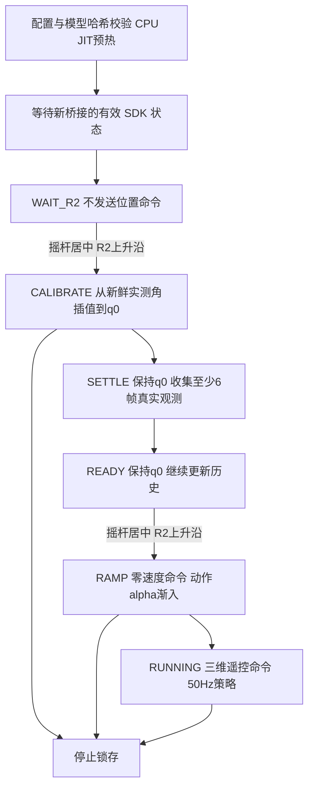

# 基于 WTW 的 HIMLoco Go1 部署

本目录的 `scripts/deploy_policy.py` 已改为 HIMLoco 部署入口。算法接口固定对应 [InternRobotics/HIMLoco 的 ef289ac 提交](https://github.com/InternRobotics/HIMLoco/tree/ef289acaa62795009363b7b819c9186690630441)，底层继续使用 WTW 的 Unitree SDK 与 LCM 消息。HIM 的训练代码、estimator 和 actor 无需修改。

当前本地目录含真实 `models/policy.pt`；`configs/himloco_go1.json` 已记录其 SHA-256，并按用户指定的 HIMLoco-Go1 默认配置填写策略关节顺序。实际训练运行的 DOF 导出记录仍未提供，配置引用中保留了这一假设。示例 JSON 继续作为空白模板。

2026-10-25 已完成被动数据的人工粗核：十二关节身份/方向以及 IMU wxyz、gyro 与机身轴向，真实 JSON 的两个 alignment 确认标记已填写，并引用 `configs/evidence/himloco_go1_physical_review_20261025.json`。右后髋采集曾先动错为左后、随后同项纠正，完整曲线与说明一致；其余联动和提前回位保留在记录中。严格自动端点报告并未改写为全部通过。R_BS 保持单位矩阵，不声明完成精密安装角、水平零点或编码器零位标定。`runtime.safety_reviewed=false` 仍保留，尚未进行 HIM 实机主动标定或策略运行。配置中的 `verified` 和记录引用是声明，不会自动验证记录内容；模型文件的 SHA-256 会实际核验。

## 算法接口

输入为 CPU float32 `[1,270]`，包含六个 45 维观测，最新帧在最前。单个 JIT 内部完成 estimator、latent 归一化和 actor 的连接，输出 float32 `[1,12]`。外部不读取 `parameters.pkl`，不调用 WTW 的 adaptation/body 两个 JIT。

| 单帧索引 | 内容 | 外部处理 |
| --- | --- | --- |
| 0:3 | 前进、侧向、偏航角速度命令 | 乘 `[2,2,0.25]` |
| 3:6 | 机身角速度 | 使用 SDK gyro，经坐标转换后乘 0.25 |
| 6:9 | 机身坐标系重力方向 | `R_WB.T @ [0,0,-1]`，单位向量 |
| 9:21 | 关节位置偏差 | 策略顺序下的 `q-q0` |
| 21:33 | 关节速度 | 策略顺序下的 `dq*0.05` |
| 33:45 | 上一动作 | 裁剪后的无量纲动作，正常运行时未乘 0.25 |

观测裁剪 ±100，策略动作裁剪 ±100。目标角为 `q0 + 0.25*action`，所有关节相同比例，不再压缩髋关节动作。名义 `Kp=40`、`Kd=1`，目标速度与前馈力矩为零。策略周期 20 ms，SDK 下发周期 2 ms。±100 是训练接口范围，不是关节机械安全范围；若目标超出 URDF 角度范围或已核准的单周期增量，控制器停止，不静默修改策略目标。

默认角按关节名称构造，单位 rad：

| 腿 | hip | thigh | calf |
| --- | ---: | ---: | ---: |
| FL | 0.1 | 0.8 | -1.5 |
| FR | -0.1 | 0.8 | -1.5 |
| RL | 0.1 | 1.0 | -1.5 |
| RR | -0.1 | 1.0 | -1.5 |

训练中的噪声、随机延迟、随机增益、外力与地形高度等不在真机端重放。这里采用三维速度命令，不实现 heading 闭环或位置保持。零命令不意味着机器人位置被锁定。

仿真还对 PD 力矩按资产 effort 上限裁剪（该 Go1 URDF 为 33.5 N·m）。本实现向 SDK 下发位置及增益，由机载伺服执行 PD，保留 SDK 功率保护；这不能证明固件逐关节力矩上限与训练完全相同，须在实机核验中确认。不能把外部算出的完整 PD 力矩再填入 `tau_ff`，否则会叠加两份 PD。

## 关节与坐标对齐

1. SDK 顺序固定为 `FR,FL,RR,RL`，每条腿内部为 `hip,thigh,calf`。
2. `model.training_dof_names` 必须填写该权重训练运行时 `gym.get_asset_dof_names()` 的真实输出。不能从 URDF XML 排列、配置字典顺序或 WTW 的旧置换推断。
3. `JointMap` 从名称构造输入置换及输出逆置换。对 SDK 反馈位置、速度执行前者，对目标角执行后者。这里的全部关节增益相同，目标速度和前馈力矩全零，与置换可交换；若将来改成逐关节不同的参数，也必须按名称映射。
4. 使用训练机身坐标：x 向前、y 向左、z 向上，右手系；角度 rad，角速度 rad/s，速度命令 m/s 与 rad/s。
5. `sensor_to_body_rotation=R_BS` 表示把传感器坐标分量转到训练机身坐标。`omega_B=R_BS@gyro_S`。姿态函数解释输入为传感器到世界的 `R_WS`，由 `R_WB=R_WS@R_BS.T` 得到机身姿态。必须确认 SDK 的姿态与 gyro 确实使用同一个输入坐标系；不满足时应另做适配，不能通过填一个错误矩阵绕过。
6. 默认 RPY 路径使用 `Rz(yaw)Ry(pitch)Rx(roll)`；保留可验证的 RPY 路径不要求修改旧四元数 getter。可选 `quaternion_wxyz` 路径直接解释 SDK 的 wxyz，不把它误当 xyzw。`q` 与 `-q` 应产生相同重力。
7. 水平姿态重力为 `[0,0,-1]`；正 roll 时左侧抬高、重力 y 分量为负；正 pitch 时机头向下、重力 x 分量为正；仅 yaw 变化不应改变水平重力。需同时核对多轴组合姿态与动态 gyro 符号，不能只测水平姿态。
8. SDK 已经输出机身 gyro 且机身轴一致时，应使用单位 `R_BS`；不要再乘姿态的逆旋转。实际 IMU 安装和 SDK 约定仍须实机确认。原始加速度不能直接代替投影重力。

示例配置的 `alignment.verified=false`，用于空白模板。实际配置已按上述实物粗核保留单位旋转及原关节置换；遥控符号 `[1,1,-1]` 仍需在 HIM 实机动作中核对，不能用 WTW 的遥控验证替代。

## 控制流程



除 WAIT_R2 和 READY 的指定启动操作外，R2 再次按下会停止；L2、Ctrl+C、状态/命令失联、姿态或跟踪异常、无效输出等也会停止。连接时已按住的 R2 不算启动请求；一个周期内出现多个 R2 上升沿也会停止。停止后重新启动桥接进程及 Python 控制器，不能靠继续发送位置命令恢复。

历史只由控制周期推进一次，读取和日志不会推进。标定结束后先等待实际位置接近 q0，再收集六帧。渐入期间记录并反馈实际应用动作 `alpha*clip(action)`；正常运行 `alpha=1` 后等同官方的上一裁剪动作。实测历史预热、标定和渐入是明确增加的部署行为，不宣称与仿真的 episode reset 完全相同。

JSONL 日志包含启动配置、周期、状态年龄、机身 gyro/重力、关节反馈、观测、270 维历史、原始/裁剪/应用动作、目标角和阶段。日志写入或推理长时间阻塞时，桥接命令 watchdog 仍独立生效。

## 桥接协议与停止行为

### 2026-10-25 启动修复与被动对齐工具

宿主桥接校验已改用 Python 3.6 支持的 `stdout/stderr=PIPE, universal_newlines=True`。

趴卧启动时，实测角可在 URDF 外最多 0.2 rad；此容差只用于等待 R2 和标定，标定中逐渐降到运行期的 0.02 rad。首条标定目标限制在 URDF 边界内 0.001 rad，首帧增益为零，Kp/Kd 在 0.5 s 内渐增至 40/1，位置仍在 3 s 内插值至默认角。策略阶段的目标限位、步长和 SDK 检查继续生效。此修复已用合成趴卧状态验证，尚未执行 HIM 实机标定。

新桥接参数 `--observe-only` 不订阅电机目标通道，持续发送 mode 0、零增益用于被动读取。该模式不受 R2 启动，仍须承托机身。`scripts/check_alignment.py` 只订阅数据，不发布电机命令；提供 `--guided imu/joints/all` 人工提示采集与离线分析。开始、结束各保持静止，中间只做本项指定动作；机器人左右以机身自身为准。

离线分析要求 RPY/四元数一致、三个独立旋转方向与 gyro 一致、十二关节物理身份和正向运动逐项通过。只有确实用水平仪检查机身刚性面水平后才能加 `--level-confirmed`。支架承托本身不能代替水平测量。分析生成候选变换和报告，**不会自动修改 JSON 的确认标记**。

人工粗核记录与严格自动通过是不同范围：本次用户接受粗略身份/方向核对，已结合完整曲线和操作纠正说明填写实际配置的 alignment 记录；未使用 `--level-confirmed`，未降低分析阈值，也未应用自由手动旋转拟合的小角度安装修正。自动报告仍可保持 false；部署时必须阅读人工记录的适用范围。

实际 Jetson SDK 3.8 的离线 `PositionLimit` 检查显示 hip 约 ±1.047、thigh 约 [-0.663,2.966]、calf 约 [-2.721,-0.837] rad。新首帧目标在检查中未被改写。SDK 的 thigh 范围比训练 URDF 窄；未来策略超出 SDK 范围仍会停止，不能据静止检查声称整段策略都能通过。

不改变现有 `.lcm` 字段布局，增加以下字段语义：

| 字段/行为 | HIM 定义 |
| --- | --- |
| `robot_id` | 正常为 `20261023`，桥接故障为 `-20261023`；拒绝旧桥接 |
| 状态 `id` | SDK `LowState.tick`，按 uint32 模运算判断推进，不假定 tick 的时间单位 |
| 状态 `timestamp_us` | 桥接观察新 tick 时生成的单调时间标记；不是 IMU/电机硬件采样时间 |
| 命令 `id` | 正数且递增；`-1` 为锁存停止 |
| 命令 `timestamp_us` | 回填该命令使用的 SDK 状态时间，不使用 Python 主机墙钟 |
| IMU 与关节 | Python 按同一个 tick 和源时间配对，重复包不延长状态有效期 |
| watchdog | SDK 状态停止推进超过 50 ms，或有效命令超过 100 ms 未更新，停止锁存 |
| 线程同步 | 命令、序号、状态新鲜度和故障门控由 mutex 保护，读取整份命令快照 |

桥接初始不发送旧名义姿态，只在通过 tick 推进检查的状态及首条有效 HIM 命令后进入 servo 模式。命令回填的时间还必须属于本桥接进程实际生成的近期状态标记，防止进程重启后误接收旧会话的命令。保留 SDK `PositionLimit` 与 `PowerProtect`；若 SDK 位置保护修改目标角，或功率保护返回负值，立即锁存停止。L2 也由桥接直接检查。

这里测量的是 SDK tick 推进及桥接/LCM 接收新鲜度，不是已校准的传感器端到端延迟。连续推进但实际积压的旧 UDP 数据不能仅凭这些标记全部识别；目标 SDK、通信负载与实际时延仍需验证。

停止输出采用 SDK 的 **mode 0（damping）**，同时设置停止哨兵位置/速度以及 `Kp=Kd=tau=0`。这不是电气断电，也不能保证机身继续承重或严格零力矩。桥接正常退出前尝试发送停止帧；进程被强杀、主机掉电、SDK 通道中断时，主机代码无法保证机器人已收到停止帧，仍需核对固件层行为和独立急停。

RC 消息本身没有源序号或时间戳。这里的 RC 超时只覆盖 LCM 接收停止；SDK tick 继续变化不证明无线遥控器仍连接。无线遥控器断链后的 SDK 行为仍须单独实测。

## 配置和启动

使用独立 JSON，复制 `configs/himloco_go1.example.json` 后填写模型路径、真实 SHA-256、训练配置记录、真实 DOF 顺序与对齐记录。不要直接把验证开关改为 true 来跳过核对。

以下数值是新增部署阈值的模板，**不是 HIM 训练参数，也未经过这台真机的验证**：标定 3 s、位置容差 0.15 rad、稳定等待 5 s、至少六帧历史、渐入 1 s、READY 等待最多 60 s、最大倾斜 0.7 rad、目标单步变化 0.08 rad、跟踪误差 1 rad、遥控上限 `[0.5,0.3,0.5]`、摇杆死区 0.05、允许周期迟到 40 ms。实际阈值须评估后记录 `runtime.safety_review_reference`。观测超时可更严格，不能大于桥接 50 ms；命令 watchdog 固定 100 ms。

准备能加载实际模型的 Python/PyTorch CPU 环境及 `requirements-himloco.txt`。保留的旧 Dockerfile 使用 WTW 的旧镜像，不自动作为 HIM 运行环境。无需安装整个训练项目或运行旧 `setup.py`。

在仓库根目录执行（以下为操作说明，本次改造没有执行任何真机启动）：

```bash
# 仅检查配置结构：不需要 policy.pt，不创建 LCM
python3 go1_gym_deploy/scripts/deploy_policy.py \
  --config go1_gym_deploy/configs/himloco_go1.example.json --inspect-config

# 在目标运行环境检查真实模型：无电机命令、无 LCM
python3 go1_gym_deploy/scripts/deploy_policy.py --config /absolute/himloco.json --check

# 在目标 Linux 平台编译 SDK 桥接，SDK 目录必须匹配实际 Go1
bash go1_gym_deploy/unitree_legged_sdk_bin/build_him_bridge.sh /absolute/unitree_legged_sdk

# 新二进制必须通过协议与源码哈希核验；仍保留人工 Enter 提示
bash go1_gym_deploy/autostart/start_unitree_sdk.sh

# 另一个终端，只观察 SDK 原始状态及配置后的重力，不发布控制命令
python3 go1_gym_deploy/scripts/deploy_policy.py --config /absolute/himloco.json --observe --duration 10

# 核验完成后，显式进入运行；仍需两次规定阶段的 R2 操作
python3 go1_gym_deploy/scripts/deploy_policy.py --config /absolute/himloco.json --run
```

自定义 LCM 地址时，桥接 `--lcm-url`/启动脚本 `HIM_LCM_URL` 必须与 JSON `runtime.lcm_url` 一致。新构建产物为 `unitree_legged_sdk_bin/build/lcm_position_him`；原有预编译 `lcm_position` 不用于 HIM 启动。

## 传输与离线测试

`scripts/send_to_unitree.sh CONFIG POLICY USER@HOST:/absolute/release [LOCAL_BUNDLE]` 构造一个新发布目录，显式打包模型为 `models/policy.pt`、配置为 `himloco.json`，生成文件 SHA-256 清单，再执行 rsync。不会自动启动机器人，不再使用排除所有 `.pt` 的旧规则。目标目录应是单独的新发布目录；传输后在目标端重新执行 `build_deployment_bundle.py --verify RELEASE_DIR` 和模型 `--check`。

```bash
python3 -m unittest discover -s go1_gym_deploy/tests/himloco -p 'test_*.py' -v

# 可选：设置为上述固定官方提交的检出根目录，启用直接源码数值对照
HIMLOCO_SOURCE_ROOT=/absolute/HIMLoco python3 -m unittest discover \
  -s go1_gym_deploy/tests/himloco -p 'test_*.py' -v

# 不依赖 SDK 和 LCM 的 C++ 门控测试
cmake -S go1_gym_deploy/unitree_legged_sdk_bin -B /tmp/him-guard -DHIM_GUARD_TEST_ONLY=ON
cmake --build /tmp/him-guard
ctest --test-dir /tmp/him-guard --output-on-failure
```

没有 PyTorch 时，合成 TorchScript 测试明确跳过；没有 `HIMLOCO_SOURCE_ROOT` 时，官方源码直接数值对照也明确跳过。即使这些测试全部通过，也不能代替真实权重在目标运行环境上的加载、计时、关节与坐标对齐、实机停止和运动验证。

旧 `envs/lcm_agent.py`、`envs/history_wrapper.py`、`utils/cheetah_state_estimator.py`、`utils/deployment_runner.py` 保留供 WTW 历史代码参考，新的入口不导入它们。对应职责已经迁移到 `himloco/contract.py`、`state.py` 和 `runner.py`，避免混用 WTW 的步态、时钟、相机及旧历史逻辑。
